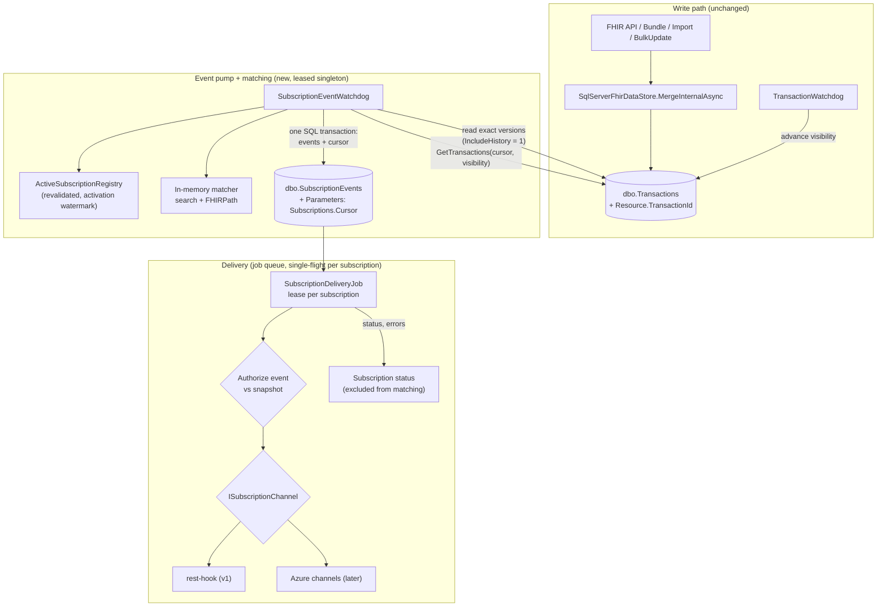

# Proposal: FHIR Subscriptions and Notifications

Labels: [SQL](https://github.com/microsoft/fhir-server/labels/Area-SQL), New-Feature

Status: Draft proposal. The decision is recorded in [ADR-2611: FHIR Topic-Based Subscriptions](../adr-2611-fhir-subscriptions.md) (Proposed). This document holds the detailed scope, design and delivery plan.

## 1. Purpose and scope

This proposal adds FHIR topic-based Subscriptions to the Microsoft FHIR Server. Clients will be able to register for server-pushed notifications when resources change. It covers:

1. The subscription features the FHIR specification defines, and which ones we will implement ([section 3](#3-feature-support-matrix)).
2. What we will explicitly **not** implement, and why ([section 4](#4-not-implementing)).
3. How the features map onto the server's existing eventing architecture, and a phased delivery plan ([sections 5-8](#5-existing-eventing-architecture)).
4. The impact on the managed Azure Health Data Services events capability ([section 9](#9-impact-on-azure-health-data-services-events)).

Normative references:

- FHIR R5 [Topic-Based Subscriptions Framework](https://hl7.org/fhir/R5/subscriptions.html), [Subscription](https://hl7.org/fhir/R5/subscription.html), [SubscriptionTopic](https://hl7.org/fhir/R5/subscriptiontopic.html), [SubscriptionStatus](https://hl7.org/fhir/R5/subscriptionstatus.html)
- [Subscriptions R5 Backport IG](https://hl7.org/fhir/uv/subscriptions-backport/) (for R4 and R4B)
- FHIR R4 [Subscription](https://hl7.org/fhir/R4/subscription.html) (base resource for Backport profiles; classic criteria-based use is not supported)

## 2. FHIR Subscriptions in brief

The framework has three parts:

| Component | Role |
|---|---|
| `SubscriptionTopic` | Defines **what** triggers a notification (a resource trigger or an event trigger), which **filters** clients may apply, and the notification **shape** (related resources to include). Always referenced by canonical URL. |
| `Subscription` | A client's request for notifications on one topic. It sets the filters, the **channel** (rest-hook, websocket, email, message, or custom), the endpoint, and the **payload** (MIME type plus `empty` / `id-only` / `full-resource`). |
| Notification `Bundle` | A `history` Bundle (`subscription-notification` in R5) whose first entry is the subscription status, followed by zero or more event payloads. |

How each FHIR version expresses these:

| FHIR version | `Subscription` | Topic | Status in notifications |
|---|---|---|---|
| **R4** | R4 `Subscription` + Backport IG extensions (`criteria` = topic canonical) | **Not a resource type in R4.** The IG leaves topic definition out of scope. This server represents topics as `Basic` resources (see 3.2). | `Parameters` (backport-subscription-status profile) |
| **R4B** | R4B `Subscription` + Backport IG extensions | `SubscriptionTopic` resource | `SubscriptionStatus` resource |
| **R5** | Native `Subscription` (`topic`, `filterBy`, `channelType`, `content`, ...) | `SubscriptionTopic` resource | `SubscriptionStatus` resource |
| R4 (classic, **not supported**) | R4 `Subscription` with `criteria` = search URL | None | None. The payload is empty or the resource itself. |

The managed Azure Health Data Services FHIR service runs R4 (4.0.x) and STU3, not R4B ([FAQ](https://learn.microsoft.com/azure/healthcare-apis/fhir/fhir-faq)). **R4 with the Backport IG is therefore the primary target**, and API-defined topics must work on R4.

**Spec conformance minimum** (R5 §3.9.7):

- `Subscription`: read and write. Search is recommended.
- The `$status` operation.
- `SubscriptionTopic`: read and search.
- At least one channel type (preferably a core one) and at least one payload type.

Delivery is **best-effort** unless a channel defines otherwise. Clients detect gaps through event numbering and heartbeats, and recover through `$status`, `$events`, or re-query.

## 3. Feature support matrix

Legend:

- ✅ **v1**: in the first release (the phase is in brackets; see [section 7](#7-phased-delivery)).
- ⏳ **Later**: planned after v1.
- ❌ **No**: not planned (see [section 4](#4-not-implementing)).

### 3.1 FHIR versions and subscription models

| Feature | Spec | Support |
|---|---|---|
| R5 topic-based subscriptions | Core R5 | ✅ v1 [2-4] |
| R4B topic-based (Backport IG) | Backport IG | ✅ v1 [2-4] |
| R4 topic-based (Backport IG) | Backport IG | ✅ v1 [2-4] |
| R4 classic criteria-based (`Subscription.criteria` = search URL) | Core R4 | ❌ No. Rejected at create; only Backport-profiled R4 subscriptions are accepted. |
| STU3 subscriptions | Core STU3 | ❌ No |

### 3.2 SubscriptionTopic

| Feature | Spec | Support |
|---|---|---|
| Create, read, update, delete and search topics **through the API**, on all supported versions | SHALL read/search; write is MAY | ✅ v1 [2]. **Required.** Writes need the new `SubscriptionTopic` permission (3.7). Topics are rejected if any trigger or filter is unsupported. |
| R4B/R5: native `SubscriptionTopic` resource | Core | ✅ v1 [2] |
| R4: topic as a `Basic` resource with `Basic.code` = `http://hl7.org/fhir/fhir-types#SubscriptionTopic`, with the R5 topic elements carried as extensions (searchable as `Basic?code=http://hl7.org/fhir/fhir-types\|SubscriptionTopic`) | Not defined by the IG (server-specific) | ✅ v1 [2]. The ADR publishes a **versioned `StructureDefinition`** for this `Basic` profile (extension URLs and cardinalities), plus a worked create → search → subscribe example. Interoperability with other servers' R4 topic representations is a goal to be tested, not a v1 guarantee. |
| Topics pre-loaded from configuration or packages (for example, IG-defined topics) | Backport IG | ⏳ Later |
| CapabilityStatement topic advertisement (`capabilitystatement-subscriptiontopic-canonical` extension) | MAY | ✅ v1 [2] |
| `resourceTrigger.resource`, including multi-resource and `Resource` topics | Core | ✅ v1 [3] |
| `resourceTrigger.supportedInteraction` create / update / delete | Core | ✅ v1 [3]. Delete means **soft delete** (see 4). |
| `resourceTrigger.queryCriteria` (`current`, `previous`, `resultForCreate`, `resultForDelete`, `requireBoth`) | Core | ✅ v1 [3]. Limited to the filter subset in 3.4. |
| `resourceTrigger.fhirPathCriteria` (`%current`, `%previous`) | Core | ✅ v1 [3] |
| `canFilterBy` (`resource`, `filterParameter`, `comparator`, `modifier`) | Core | ✅ v1 [2-3] |
| `notificationShape.include` / `revInclude` | Core | ⏳ Later [5] |
| `eventTrigger` (non-REST business events) | Core | ❌ No |
| Topic versioning, `derivedFrom` resolution | Core | ⏳ Later |

### 3.3 Subscription

| Feature | Spec | Support |
|---|---|---|
| Create, read, update, delete, search `Subscription` | SHALL read/write, SHOULD search | ✅ v1 [2] |
| Validation at create or update (topic, filters, channel, endpoint, payload), returning `OperationOutcome` on rejection | SHOULD | ✅ v1 [2] |
| `status` lifecycle: `requested` → `active` → `error` / `off`; `entered-in-error` | Core | ✅ v1 [4]. Only the server sets `active` or `error`. A client may set `requested` (to retry after an error) or `off`. See 3.6. |
| `filterBy` (R5) / `backport-filter-criteria` extension (R4/R4B) | Core / IG | ✅ v1 [3]. Uses the subset in 3.4. |
| `end` (auto-deactivate) | Core | ✅ v1 [4] |
| `heartbeatPeriod` | Core | ✅ v1 [4]. Server enforces a minimum. |
| `timeout` | Core | ✅ v1 [4]. Capped by server configuration. |
| `maxCount` (multiple events per notification) | Core | ✅ v1 [4]. Capped by server configuration. |
| `contentType` `application/fhir+json`, `application/fhir+xml` | Core | ✅ v1 [4] |
| `content` / `backport-payload-content`: `empty`, `id-only`, `full-resource` | SHALL ≥1 | ✅ v1 [4]. **`id-only` is the default.** The Backport profile makes the content extension mandatory (1..1), so if a client omits it, the server adds `id-only` to the accepted resource. The spec allows the server to adjust a request; the client sees the accepted value in the response. `full-resource` can be restricted by policy (3.7). |
| `fhirVersion` MIME parameter other than the server's version | SHALL NOT accept if unsupported | ❌ No. Rejected at create. |
| `parameter` (R5) / `channel.header` (R4) as HTTP headers | Core | ✅ v1 [4]. Never logged. See 10 for redaction on read. |
| `managingEntity`, `contact`, `reason`, `name`, `identifier` | Core | ✅ Stored only; no behaviour. |

### 3.4 Filter and criteria evaluation

Filters and criteria are evaluated **in memory** against the changed resource (and its previous version), using the server's existing search parameter definitions.

| Feature | Support |
|---|---|
| Search parameter types: token, string, reference, date, number, quantity, uri | ✅ v1 [3] |
| Comparators `eq`, `ne`, `gt`, `lt`, `ge`, `le`, `sa`, `eb`, `ap` (where valid for the type) | ✅ v1 [3] |
| Modifiers `:missing`, `:exact`, `:contains`, `:not`, `:text` (token) | ✅ v1 [3] |
| Custom search parameters (`SearchParameter` resources in the `Supported`/`Enabled` state) | ✅ v1 [3] |
| Composite search parameters | ⏳ Later |
| Chained parameters, reverse chaining (`_has`), `_include` in criteria | ❌ No. These need a database query per event, and are rejected at create. |
| `:above` / `:below` / `:in` / `:not-in` (terminology) | ❌ No. Rejected at create. |
| `_text`, `_content`, `_filter`, `_query`, semantic search | ❌ No. Rejected at create. |

### 3.5 Channels

| Channel | Spec | Support |
|---|---|---|
| `rest-hook` (HTTPS POST of the notification Bundle) | Core | ✅ v1 [4] |
| Custom Azure channels: Event Grid, Service Bus, Storage (custom `channelType` codes, Managed Identity) | Allowed (custom codes) | ⏳ Later [5] |
| `websocket` (+ `$get-ws-binding-token`) | Core | ❌ No |
| `email` | Core | ❌ No |
| `message` (FHIR Messaging Bundle) | Core | ❌ No |

### 3.6 Notifications, lifecycle and operations

| Feature | Spec | Support |
|---|---|---|
| `event-notification` | Core | ✅ v1 [4] |
| `handshake` on activation | **SHALL** for rest-hook (R5 and Backport) | ✅ v1 [4]. **Mandatory, not configurable.** A new or re-requested rest-hook subscription stays `requested` until a handshake is accepted (2xx), then becomes `active`. A failed initial handshake sets `error`. |
| `heartbeat` | Core | ✅ v1 [4] |
| `query-status` via `$status` (instance and type level) | **SHALL** | ✅ v1 [4] |
| `query-event` via `$events` (replay past events) | MAY | ⏳ Later [5]. Limited to the server's retention window. |
| `eventsSinceSubscriptionStart` / `notificationEvent.eventNumber` (gap detection) | Core | ✅ v1 [3-4]. Monotonic per subscription. |
| `notificationEvent.focus` | Core | ✅ v1 [4] |
| `notificationEvent.additionalContext` | Core | ⏳ Later [5], with `notificationShape`. |
| `SubscriptionStatus.error` reporting | Core | ✅ v1 [4] |
| Error handling: bounded retries with back-off, then `error`; persistent failure, then `off`; client resets to `requested` | SHOULD | ✅ v1 [4]. Undelivered events are **retained** (within the retention window) while in `error`, so they can be delivered after recovery or, later, through `$events`. |
| Ordered dispatch per subscription | Not required | ✅ v1 [4]. **One notification in flight per subscription.** Event *n+1* is not sent until event *n* succeeds or exhausts its retries. A failing endpoint blocks only its own subscription. |
| Durable, retried delivery **attempts** with stable event numbers (a retry reuses the same `eventNumber`) | Best-effort required | ✅ v1 [4]. Receipt is **best-effort**, as the spec defines: an endpoint that stays down past the retry limit will not receive the event until it recovers. Duplicates are possible; clients deduplicate by `eventNumber`. |
| Guaranteed (reliable) channel semantics | Optional | ❌ No |

### 3.7 Security

| Feature | Spec | Support |
|---|---|---|
| **Create-time authorization.** On create or update, the subscriber's identity, roles and SMART scopes/compartment are captured as an **authorization snapshot**. The topic and filters must fall within that snapshot (for example, a patient-scoped caller must filter to their own compartment). | SHALL enforce policy | ✅ v1 [2] |
| **Delivery-time authorization for every event, at every content level** (`empty`, `id-only`, `full-resource`), including retries and status counts. Each event is checked against the stored snapshot; events outside it are never sent. | SHOULD ensure authorization is still in place | ✅ v1 [4]. The server cannot re-validate a token or detect identity-provider revocation without a live request, so the check is against the snapshot, not live authorization. **Revocation** works by: (a) the subscriber or an admin setting `off` or deleting the subscription; (b) a configurable maximum subscription lifetime (enforced by `end`), which forces periodic re-subscription and therefore a fresh snapshot; (c) re-evaluating local role assignments (server RBAC configuration) at delivery time. |
| New `DataActions.SubscriptionTopic` permission. It is required whenever **either the existing or the new** resource is a topic (the R4B/R5 `SubscriptionTopic`, or an R4 `Basic` with the topic code), covering create, update, delete and conditional variants. Reading and searching topics needs only `Read`. | Server policy | ✅ v1 [2]. Mirrors the existing `DataActions.SearchParameter` pattern. `DataActions.All` must be extended to include it. |
| **Registry-time revalidation.** `$import` and bulk update bypass the MediatR validation pipeline, so the registry validates every `Subscription` and topic again (topic, filters, channel, endpoint policy, authorization snapshot) before activating it. Invalid resources are never activated; the server sets the subscription to `error` with a reason. Valid content is not enough: activation also requires a server-owned grant bound to the subscription version and endpoint (design decision 8), so imported subscriptions stay inactive until an authorized caller activates them. | Server policy | ✅ v1 [2]. Prevents server-side request forgery (SSRF) and unauthorized data disclosure through imported subscriptions. |
| HTTPS-only endpoints, a configurable endpoint allow-list, and blocking of private and link-local addresses | Recommended | ✅ v1 [2] |
| Restricting `full-resource` per client or role | MAY | ✅ v1 [4] (configuration) |
| Tracking sent notifications as `AuditEvent`/`Communication` resources | Encouraged | ❌ No. Uses the server's existing audit logging and telemetry instead. |

### 3.8 Change sources that trigger notifications

| Source | Support |
|---|---|
| REST create, update, patch, soft delete, and conditional variants | ✅ v1 |
| Batch and transaction bundles (only committed entries notify) | ✅ v1 |
| `$import`, bulk update, bulk (soft) delete | ✅ v1. They can produce high volume, and long-running batches delay all notifications (see 5 and 10). `Subscription`/topic resources written this way are subject to registry-time revalidation (3.7). |
| Server-originated `Subscription` bookkeeping (status, error and event-count updates) | ❌ No. Excluded from matching to prevent notification loops. |
| Hard delete (`_hardDelete`), `$purge-history` | ❌ No |
| Cosmos DB data store | ❌ No |

## 4. Not implementing

| Item | Reason |
|---|---|
| **`eventTrigger` topics** | Requires a business-event model the server doesn't have. Only resource changes are observable. |
| **R4 classic criteria-based subscriptions** (`Subscription.criteria` = search URL, R4 `channel.payload` semantics, `sms` channel) | Superseded by topic-based subscriptions (the R5 framework and the Backport IG). Supporting both models doubles the validation and notification formats. R4 `Subscription` resources without the Backport profile are rejected with `OperationOutcome`. |
| **websocket, email, message channels**, `$get-ws-binding-token` | Each needs new connection-management or infrastructure (persistent sockets across instances, SMTP, messaging endpoints) with limited demand. rest-hook plus Azure-native channels cover the integration scenarios. Can be revisited as separate proposals. |
| **Guaranteed or exactly-once delivery** | The spec defines best-effort delivery. We provide durable, retried attempts with stable event numbers, ordered dispatch and gap detection. |
| **Cross-version notifications** (`fhirVersion` MIME parameter ≠ server version) | Each server instance runs one FHIR version. Requests are rejected at create, as the spec requires. |
| **Database-evaluated criteria** (chained, `_has`, terminology modifiers, `_filter`, full-text, semantic) | A query per event per subscription doesn't scale. They are rejected at create time, not silently ignored. |
| **R4 topics in a non-`Basic` form** (for example, an R4B-shaped `/SubscriptionTopic` endpoint on an R4 server) | `Basic` keeps R4 topics as valid R4 resources that work with the existing REST, search, history and authorization, without a non-standard endpoint. |
| **Hard delete and `$purge-history` notifications** | Data is physically removed, and the current schema doesn't expose those keys to the event source. This matches the Azure Health Data Services events contract (section 9). |
| **Cosmos DB** | No ordered transaction log equivalent exists. It would need a separate change-feed design. |
| **STU3** | The framework isn't defined for STU3, and there is low demand. |
| **`AuditEvent` per notification** | Volume. Existing audit logging is used. |
| **Backfill / trigger operations** (not in the spec) | Non-standard. They may be proposed later as a server extension. |

## 5. Existing eventing architecture

No subscription feature exists on `main`. These building blocks exist:

| Building block | Location | Relevance |
|---|---|---|
| **Transactions table + visibility watermark** (SQL) | `Features/Schema/Sql/Tables/Transactions.sql`; sprocs `MergeResourcesBeginTransaction`, `MergeResourcesCommitTransaction`, `MergeResourcesAdvanceTransactionVisibility`, `MergeResourcesGetTransactionVisibility`, `GetTransactions`, `GetResourcesByTransactionId` | Every SQL write through `SqlServerFhirDataStore.MergeInternalAsync` opens a transaction row, and every `Resource` row records its `TransactionId`. `TransactionWatchdog` advances a gapless **visibility watermark** up to (not past) the oldest incomplete transaction, and rolls forward timed-out transactions. Transaction IDs are allocated when a transaction begins, so this order is consistent but not strictly commit order. This is a durable, ordered outbox. |
| **EventsReader POC** | `tools/EventsReader/Program.cs` | Demonstrates the polling shape: poll the watermark, call `GetTransactions(last, current)`, read keys per transaction, and persist a cursor in `dbo.Parameters`. **It is not a correct reader to copy.** `GetTransactions` returns at most 10,000 rows, but the POC checkpoints the *visibility watermark* rather than the last transaction it processed, so a backlog over one page is skipped. It also has no crash-consistency between processing and checkpointing. |
| **Resource change capture** (SQL) | `ResourceChangeData` table, `CaptureResourceIdsForChanges`, `FetchResourceChanges_3`, `SqlServerFhirResourceChangeDataStore : IChangeFeedSource<ResourceChangeData>` | Controlled by `CoreFeatureConfiguration.SupportsResourceChangeCapture` (default `false`). It records create, update, and soft delete from `MergeResources`; hard delete is not recorded. No consumer exists in this repository. It is presumed to feed Azure Health Data Services events (section 9). |
| **MediatR request pipeline** | `Shared.Core/Features/Resources/*` handlers, `IPipelineBehavior<>` (for example `CreateOrUpdateSearchParameterBehavior`) | The place to **validate** `Subscription` and `SubscriptionTopic` writes. Not suitable for emitting events: it runs before commit and is bypassed by import and bulk jobs. |
| **Durable job queue** | `Microsoft.Health.TaskManagement` (`JobHosting`, `IJobFactory`, `IQueueClient`), `JobType`/`QueueType` | An orchestrator/processing job pattern with retries and heartbeats. `tools/AsyncJobGenerator` scaffolds new job types. |
| **Watchdogs** | `SqlServer/Features/Watchdogs` (`Watchdog<T>`, `WatchdogLease`) | A leased singleton loop across instances. |
| **Search stack** | `ISearchIndexer`, `ISearchOptionsFactory`, `Features/Search/Expressions`, `IFhirPathProvider` | Parses criteria and indexes a resource in memory. No in-memory expression evaluator exists on `main`. |
| **Cross-instance cache sync** | ADR `adr-2603-load-independent-search-param-cache-sync.md` | A pattern for a shared active-subscription registry. |

**Gaps:**

- **Hard delete and `$purge-history`** use `HardDeleteResource.sql`. They open a `Transactions` row only when change capture is on, and even then they tag rows with `HistoryTransactionId`, so `GetResourcesByTransactionId` does not return them.
- **Cosmos DB** has no ordered transaction log.
- **Historical rows.** `GetResourcesByTransactionIdAsync` (the resource-returning overload) uses `@IncludeHistory = 0`. If a resource is updated again before matching reaches the earlier transaction, that earlier version is already history and is silently dropped, losing an event. The earlier prototype had this defect.
- **Previous version.** `queryCriteria.previous` and `%previous` need the prior version. `InvisibleHistoryCleanupWatchdog` may remove it.
- **Head-of-line latency.** `MergeResourcesAdvanceTransactionVisibility` stops at the oldest *incomplete* transaction. A long `$import` batch, or a stalled transaction until `TransactionWatchdog` times it out (6 × heartbeat period), delays notifications for **every** subscription on the server. This is the price of a gapless, ordered event stream.

**Prior art:** closed PRs #4474, #4628 and #5478 prototyped a `Microsoft.Health.Fhir.Subscriptions` project. They used a watchdog over `Transactions`, an orchestrator job that matched in memory, per-subscription processing jobs, rest-hook/Storage/Event Grid channels, and an R4 Backport converter. This proposal reuses that shape. It batches transactions per job rather than creating one job per transaction, and it defines the scope above explicitly. See [section 11](#11-lessons-from-prior-attempts-and-delivery-guardrails) for why those PRs did not merge.

## 6. Implementation design

### Event source options

Two existing sources can feed the matcher. Both are read-only uses of existing data, and both sit behind `ITransactionEventSource`, so the matcher and delivery are the same either way. They are not interchangeable underneath: the cursor, deduplication key and activation watermark in the design decisions below are written for `Transactions`, and would be redefined for the change feed.

| | `Transactions` (preferred) | `ResourceChangeData` change feed (alternative) |
|---|---|---|
| Availability | Written on every SQL write | Only when `SupportsResourceChangeCapture` is on |
| Added write cost | None | One insert inside every write, if capture is not already on |
| Ordering for readers | Visibility watermark (consistent order; IDs are allocated at transaction begin, so not strictly commit order); no new locks on writes | Identity order; the existing reader holds a `TABLOCK, HOLDLOCK` that can block concurrent writes (impact not measured) |
| Retention | Can be held back by the subscription cursor | Not managed in this repository; presumed owned by the managed events pipeline (unverified). A lagging reader could lose events |
| Coverage | Create, update, soft delete, `$import`, bulk, including historical versions loaded by `$import` | Same, except historical versions (only `IsHistory = 0` rows are captured) |
| Main drawback | Head-of-line latency during long transactions | Lock contention and coupling to the managed events configuration |

The choice between the two is open for product group guidance, and is recorded in ADR-2611 before it is accepted. Two related product questions should be answered with it: should historical versions loaded by `$import` produce notifications, and is change capture (with its retention) a supported dependency for this feature?

### Design decisions (to be settled in an ADR)

1. **Event source is `Transactions`** (preferred; see the options above). It is always on, consistently ordered, and covers import and bulk operations. `ResourceChangeData` is not modified (section 9); it remains the documented alternative.
2. **Cursor semantics (no loss, no double-numbering).**
   - The cursor is the **last transaction ID whose matching results are durably committed**, never the visibility watermark. The pump pages through `GetTransactions` until it reaches the watermark, so backlogs larger than 10,000 transactions are fully processed.
   - Matching output (`SubscriptionEvents` rows) and the cursor advance are written in **one SQL transaction**. A crash before commit replays the batch; a crash after commit does not.
   - `SubscriptionEvents` has a unique key on `(SubscriptionId, TransactionId, ResourceTypeId, ResourceSurrogateId)`, so a replayed batch cannot create duplicate events or consume extra event numbers. This guarantees one **logical** event per match; it does not prevent the same notification being delivered more than once (decision 7).
   - Required tests: a backlog of more than 10,000 transactions, and a process kill between matching and commit.
3. **Version-exact matching.** The matcher reads each transaction with `@IncludeHistory = 1` and evaluates **the exact version written by that transaction**, even if it is already historical. The previous version for `queryCriteria.previous` / `%previous` is the immediately preceding version by `(type, id, version - 1)`. If either version is unavailable (for example, removed by history cleanup), the event is **not silently dropped**: it is recorded with `Status = Unevaluable` and surfaced through `SubscriptionStatus.error` and metrics. `InvisibleHistoryCleanupWatchdog` must not remove history newer than the subscription cursor.
   - **History configuration limit.** The cleanup gate protects only history the server keeps. When `KeepHistory` is false for a write (a resource type with `no-version` versioning, or a metadata-only update with meta history disabled), `MergeResources` replaces the previous row's body with an "invisible" marker when change capture is on, or **deletes the row in the same write** when it is off. In the first case the event can be recorded as `Unevaluable`; in the second the earlier version leaves no trace and would be lost silently. The product group decides between requiring history for resource types used by subscriptions, or documenting a weaker guarantee for those types. Required test: two rapid updates to a resource type with history disabled, with change capture both on and off.
4. **Activation watermark.** When a subscription becomes `active` (after handshake), the server records the current visibility watermark as its `ActivationTransactionId`. It matches only transactions **after** that point, so a new subscription never receives earlier changes. Topic updates and subscription `off`/delete take effect for transactions after the change is visible; batches already matched keep their results.
5. **In-memory matching** through a new evaluator in `Core/Features/Search/InMemory`, reusing `ISearchIndexer`/`ISearchOptionsFactory` and `IFhirPathProvider`. Unsupported criteria are rejected when the subscription or topic is written (3.4).
6. **Durable per-subscription outbox.** A new `dbo.SubscriptionEvents` table stores `(SubscriptionId, EventNumber, TransactionId, ResourceTypeId, ResourceSurrogateId, ResourceVersion, Interaction, Status, Attempts, NextAttemptDate)`. It provides stable event numbers, retries with back-off, retention for later replay, and isolation between endpoints.
7. **Single-flight delivery.** At most one notification is in flight per subscription, which preserves `eventNumber` order. A delivery lease per subscription prevents two workers sending concurrently.
8. **Registry with revalidation.** Active subscriptions and topics are cached per instance. The cache refreshes when a `Subscription` or topic change is seen, and periodically through the cache-sync pattern. Every resource is revalidated on load (3.7), because `$import` and bulk paths bypass write-time validation. Revalidation checks content, not who authorized it: a subscription is activated only when it has a server-owned **activation grant** (the authorization snapshot) bound to its current version and endpoint. Subscriptions written or changed without one, including through `$import` or bulk operations, stay inactive (no handshake, no notifications) until an authorized caller activates them through the API.
9. **Loop prevention.** Writes the subscription engine makes to `Subscription` resources (status, error, event counts) are tagged and excluded from matching.
10. **Canonical internal model.** An R5-shaped internal model is used for all versions, with converters for R4 Backport, R4B and R5, following the Backport IG recommendation to use R5 definitions internally. On R4, `SubscriptionTopic` is converted to and from `Basic` (topic code plus extensions).
11. **Opt-in.** `Subscriptions:Enabled` defaults to `false` and is independent of `SupportsResourceChangeCapture`. SQL Server only.

## 7. Phased delivery

| Phase | Scope | Key work items |
|---|---|---|
| **0. ADR and spike** | Decisions in 6 | Agree ADR-2611, including the event source choice (product group guidance). Benchmark version-exact resource reads at CI-sized data, measure head-of-line latency during a long `$import` and set a latency target, confirm the history-cleanup gate, and publish the R4 `Basic` topic `StructureDefinition`. |
| **1. Event pump** | SQL, feature flag | `SubscriptionsConfiguration`; `SubscriptionEvents` schema migration (own PR, backward compatible); `SubscriptionEventWatchdog` with paged reads and the atomic events + cursor commit (design decision 2); `ITransactionEventSource` (Core) with a SQL implementation reading `@IncludeHistory = 1`; backlog and crash tests. No changes to `ResourceChangeData`. |
| **2. Resources, validation, registry** | Write side | Version converters (including R4 `Basic` ↔ topic); `Subscription`/topic validation behaviours; `DataActions.SubscriptionTopic` (old-or-new rule); authorization snapshot capture; endpoint security policy; registry with revalidation and activation watermark; CapabilityStatement entries (`instantiates`, `supportedProfile`, topic canonicals). |
| **3. Matching** | Core | In-memory evaluator (3.4); `queryCriteria`/`fhirPathCriteria` with previous/current; `Unevaluable` handling; loop prevention. |
| **4. rest-hook delivery and v1 release gate** | Core + Api | Notification Bundle builder (all three content levels, JSON/XML, per FHIR version); `RestHookChannel`; mandatory handshake; heartbeat; status lifecycle; `end`; `$status`; single-flight delivery; delivery-time authorization; metrics and logging; `SubscriptionEvents` retention watchdog; `docs/Subscriptions.md` and `docs/rest/Subscriptions.http`. **v1 ships only when the release gate below passes.** |
| **5. Post-v1** | Api | `$events`; `notificationShape` and `additionalContext`; Azure channels (Event Grid, Service Bus, Storage); topics pre-loaded from packages. |

**First milestone (end of phase 4, before any post-v1 work):** a single R4 Backport flow, end to end:

1. Create an API-defined topic (R4 `Basic`) with `DataActions.SubscriptionTopic`.
2. Create an `id-only` rest-hook subscription, and confirm the server adds the content extension.
3. Complete the mandatory handshake: `requested` → `active`.
4. Deliver one authorized event.
5. Repeat with the worker killed mid-batch (no loss, no duplicate event numbers), and with authorization revoked between matching and delivery (event not sent).

**v1 release gate:**

- E2E tests against a local webhook receiver for R4 Backport, R4B and R5 payloads (`Parameters` vs `SubscriptionStatus` as the first entry), validated against the Backport and R5 profiles.
- Handshake transitions: success → `active`; failure → `error`.
- Backlog over 10,000 transactions and crash-replay tests pass.
- Load test (`tools/PerfTester`) results, including head-of-line latency during `$import`, meet the phase 0 target.
- Regression tests with `Subscriptions:Enabled=false`, and with both subscriptions and `SupportsResourceChangeCapture` enabled, show no change to existing behaviour.

## 8. Code placement

| Component | Project |
|---|---|
| Configuration, `ISubscriptionChannel`, `ITransactionEventSource`, in-memory evaluator, registry, delivery job, authorization snapshot | `Microsoft.Health.Fhir.Core` (or a new `Microsoft.Health.Fhir.Subscriptions` project) |
| Version converters, notification Bundle builder | `Microsoft.Health.Fhir.Shared.Core` |
| Validation behaviours, `$status`/`$events` endpoints, registration | `Microsoft.Health.Fhir.Shared.Api` |
| Event pump and matching watchdog, SQL event source, `SubscriptionEvents` table and sprocs | `Microsoft.Health.Fhir.SqlServer` |

## 9. Impact on Azure Health Data Services events

[Azure Health Data Services events](https://learn.microsoft.com/azure/healthcare-apis/events/events-overview) is a managed capability. It publishes `FhirResourceCreated`, `FhirResourceUpdated`, and `FhirResourceDeleted` (soft delete only) to an Event Grid system topic. Customers can filter events, and delivery includes retries, dead-lettering, and at-least-once semantics. The [FAQ](https://learn.microsoft.com/azure/healthcare-apis/events/events-faqs) states that events are not ordered within bundles, are not emitted for failed transaction bundles, and are capped at 5,000 events per second per workspace. The publisher is not in this repository. The OSS server exposes `ResourceChangeData` through `IChangeFeedSource<ResourceChangeData>` when `SupportsResourceChangeCapture` is on, and the managed pipeline is presumed to consume it. The internal implementation must confirm this assumption before the ADR is accepted.

| Aspect | Azure Health Data Services events | This proposal |
|---|---|---|
| Purpose | Platform/integration events: every change, coarse-grained | FHIR-standard, client-managed subscriptions with server-side filtering |
| Configured by | Azure control plane (Event Grid subscription, ARM/RBAC) | FHIR API (`POST Subscription`), FHIR authorization and SMART scopes |
| Filtering | Event Grid filters on event type and metadata | FHIR search criteria, `SubscriptionTopic` triggers, `filterBy`, FHIRPath |
| Payload | Event Grid schema: resource type, ID, version, account; no resource body | FHIR notification Bundle (`empty`/`id-only`/`full-resource`) with `SubscriptionStatus` |
| Source | `ResourceChangeData` (presumed) | `Transactions` + `Resource.TransactionId` (preferred); `ResourceChangeData` as a read-only alternative (section 6) |
| Ordering / replay | No ordering guarantee; no replay of past changes | Ordered dispatch by `eventNumber` per subscription; undelivered events retained; `$events` replay post-v1 |

**Required invariants (no behaviour change for existing events):**

1. **No schema or contract changes** to `ResourceChangeData`, `ResourceChangeType`, `CaptureResourceIdsForChanges`, `FetchResourceChanges_3`, the partitioning sprocs, or `SqlServerFhirResourceChangeDataStore`. All new storage is additive: a `SubscriptionEvents` table and a new `Parameters` key.
2. **`SupportsResourceChangeCapture` stays independent** of the new `Subscriptions:Enabled` flag. Either can be on without the other.
3. **No synchronous step is added to the write path.** Matching runs asynchronously after visibility, so a subscription cannot cause a write to fail or wait. Subscriptions do add load to the shared database (reads and `SubscriptionEvents` writes), which must be measured; see below. Events fire only for committed changes, which is consistent with the managed service not emitting events for failed transaction bundles.
4. **Hard-delete semantics are unchanged.** Hard delete stays out of both feeds in v1.

**Shared costs to monitor when both are enabled:**

- Additional reads against `Transactions` and `Resource` from the matching job, plus `SubscriptionEvents` writes. Measure these against the database budget alongside the `ResourceChangeData` writes, which are made inside `MergeResources`.
- Interaction with `InvisibleHistoryCleanupWatchdog`. The managed pipeline does not depend on history, but version-exact matching does, so cleanup is gated on the subscription cursor (design decision 3).

**Product positioning:**

- Present the two features as complementary. Events are for Azure-native fan-out of all changes. Subscriptions are for FHIR-standard, consumer-managed, filtered notifications such as Da Vinci or Backport IG clients.
- The proposed Azure Event Grid channel (post-v1, phase 5) sends FHIR notification Bundles to a customer-owned topic. It must not reuse the `Microsoft.HealthcareApis.*` event types, to avoid confusion with system-topic events.
- Longer term, an ADR could evaluate whether the managed events publisher should move to the `Transactions`-based pump, which would give it the same gapless ordering. It would **not** by itself add hard-delete coverage, because hard deletes are not exposed through `TransactionId` (section 5). Doing so is not required by, and not part of, this proposal.

## 10. Risks and open questions

- **Event source.** `Transactions` (preferred) or the `ResourceChangeData` change feed (section 6). Awaiting product group guidance.
- **Throughput.** Matching cost is roughly *(changed resources) × (active subscriptions)*, and matching runs in a single leased pump. Index subscriptions by resource type and interaction, parallelise evaluation *within* a batch (committing in order), and make the number of active subscriptions configurable with a cap. If one pump is insufficient, partitioning by resource type is the fallback; the phase 0 benchmark decides.
- **Head-of-line latency.** Long `$import` batches or stalled transactions delay all notifications (section 5). Decide the latency target and whether `$import` should opt out of notifications per operation.
- **Write amplification.** Each match adds a `SubscriptionEvents` row; the retention watchdog is in the v1 gate.
- **History retention.** Gating `InvisibleHistoryCleanupWatchdog` on the cursor delays cleanup while the pump is behind. Define a maximum lag after which events are recorded as `Unevaluable` instead of blocking cleanup. Separately, decide whether subscribed resource types must keep history (design decision 3).
- **Authorization snapshot limits.** Snapshot-based checks cannot see identity-provider revocation. Decide the default maximum subscription lifetime, and whether certain roles may hold longer-lived subscriptions.
- **Header secrets on read.** The spec says `Subscription` is not secret storage. Decide whether to redact `parameter`/`channel.header` values for readers without write permission.
- **Topic deletion and updates with active subscriptions.** Decide whether to reject topic deletion while subscriptions reference the topic, and whether trigger changes require subscriptions to be re-requested.

## 11. Lessons from prior attempts and delivery guardrails

### 11.1 What happened

None of the earlier PRs was rejected in review. None received human review comments; the only reviewer activity was automated CodeQL findings. No closing rationale was recorded beyond "We will reopen the PR" on #4474. They stalled and were closed:

| PR | Size | Outcome | Observed issues |
|---|---|---|---|
| #4474 "Subscription Feature" (Aug 2024) | +3,761 / 93 files | Draft. Closed after three weeks with "We will reopen the PR". | Superseded by #4628 from the same branch. Template description left unfilled. CodeQL reported 20+ potential problems. |
| #4628 "[Feature] Subscriptions engine" (Sep 2024) | +3,688 / 81 files | Marked ready for review, then sat **six months with no review**. Closed without comment in Apr 2025. | Single large PR spanning a new project, Core, Api, SqlServer, the job framework and search. No ADR or linked issue. Template description unfilled. Depended on unmerged #3814 when opened. No recorded CI result. CodeQL 20+ findings. |
| #5478 "[DO NOT REVIEW] Add subscriptions and SqlonFhir View Definitions" (Mar 2026) | +81,063 / 235 files | Closed by the author in Oct 2026. | Explicitly a demo branch (the plan targeted a DevDays 2026 presentation). It combined subscriptions with SQL-on-FHIR, a new SDK, and a Parquet/Fabric materializer. The `Check Metadata` validation was failing. Not intended for merge. |

**Likely root causes.** These are inferred, because no closing rationale was recorded:

1. **No agreed design up front.** None of the PRs had an accepted ADR or a scope statement. Reviewers had to assess architecture, scope and code in one pass.
2. **PRs too large to review**, touching many layers, plus the storage schema, in one change.
3. **Scope coupling.** Subscriptions were bundled with unrelated features (#5478) or with unmerged prerequisites (#4628).
4. **No visible reviewer assignment or linked work item.** Whether this reflected missing ownership or a priority decision is not recorded.
5. **Prototype-level quality signals:** unfilled template, CodeQL findings, incomplete tests ("functional but limited test coverage" per the #5478 plan), and no performance evidence for the write-path-adjacent design.

For contrast, related work taken through the normal process did merge: the watchdog cleanup that #4628 depended on (#3814), and the FHIRPath engine work, which went through ADR `adr-2608-ignixa-sdk-migration.md` and merged as staged PRs such as #5801. Neither was split out of the subscription branches, but both show that ADR-first, incremental PRs get reviewed.

### 11.2 Guardrails for this effort

| # | Guardrail | Addresses |
|---|---|---|
| 1 | **ADR first.** [ADR-2611](../adr-2611-fhir-subscriptions.md) records the decision and must be **accepted by maintainers before feature code is opened for review.** It fixes the scope in sections 3-4 and the decisions in section 6. Code PRs link to the ADR. | 1 |
| 2 | **One PR per phase or sub-phase** (section 7). Target roughly 1,000 changed lines or fewer of non-generated code, touching as few layers as possible. Schema migrations go in their own PR. Each PR builds, passes tests, and is inert behind `Subscriptions:Enabled=false`, so it can merge without completing the feature. | 2 |
| 3 | **Strict scope.** Only subscriptions. SQL-on-FHIR, analytics materialization, and new channels beyond v1 are separate proposals. Prerequisites (for example, the in-memory evaluator, or the `DataActions.SubscriptionTopic` permission) merge first as standalone PRs with their own value and tests. | 3 |
| 4 | **Ownership.** A tracking issue or work item with an owner, a named maintainer reviewer per phase, and a milestone. PRs carry the required labels and milestone so `Check Metadata` passes. A PR left unreviewed for two sprints is escalated in triage rather than left open. | 4 |
| 5 | **Merge bar per PR:** PR template completed; CI green; zero new CodeQL findings; unit tests (xUnit/NSubstitute, Arrange-Act-Assert) for new behaviour; E2E tests for HTTP-facing changes; SQL changes include the static index and query assessment required by `AGENTS.md`. | 5 |
| 6 | **Evidence before scale-sensitive phases.** Phase 0 benchmark results (event pump throughput, head-of-line latency, added database load) are attached to the ADR. Phase 3 and 4 PRs include load-test numbers from `tools/PerfTester`. The v1 release gate (section 7) must pass before release. | 5 |
| 7 | **No long-lived feature branch.** Phases merge to `main` incrementally (behind the flag) instead of accumulating on a branch that drifts from `main`. | 2, 3 |
