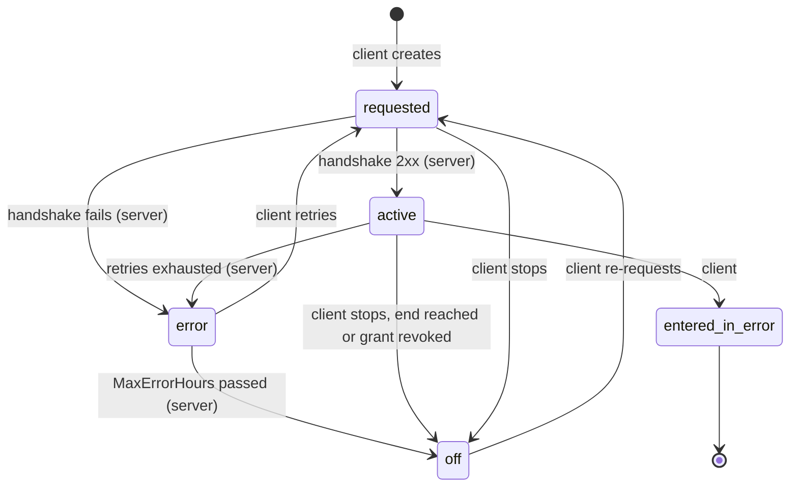
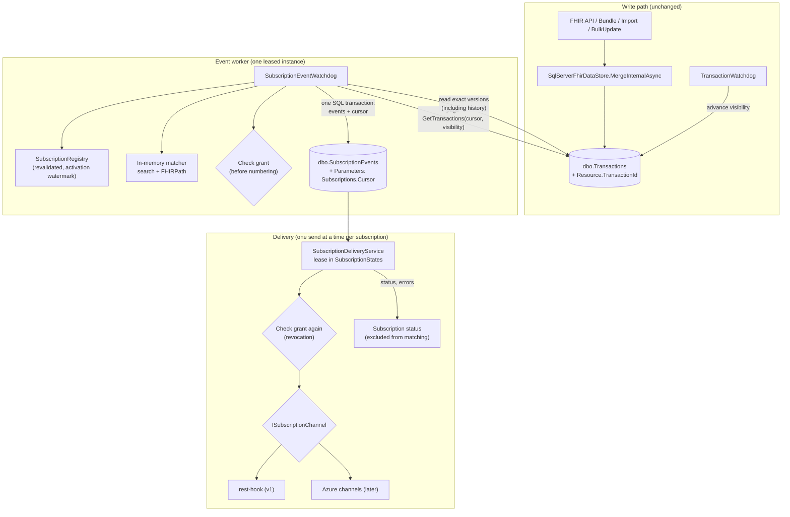

# Proposal: FHIR Subscriptions and Notifications

Labels: [SQL](https://github.com/microsoft/fhir-server/labels/Area-SQL), New-Feature

Status: Draft proposal. [ADR-2611: FHIR Topic-Based Subscriptions](../adr-2611-fhir-subscriptions.md) records the decision and the questions for the product group (PG). This document has the scope, design, release gate and delivery plan. The ADR and this proposal are reviewed before any feature code.

## Summary

- **What customers get:** standard FHIR notifications when resources change. Clients define a topic, subscribe with filters, and receive notifications at their own HTTPS endpoint. R4 (Backport IG) is the main target. R4B and R5 are also supported.
- **v1 scope:**
  - API-defined topics on all versions. R4 uses `Basic` resources.
  - The rest-hook channel with handshake.
  - `empty`, `id-only` and `full-resource` payloads.
  - `$status`.
  - In-memory filters using the server's search parameters.
- **Not in v1:** websocket, email and message channels; classic R4 subscriptions; database-evaluated filters (chains, `_has`, terminology); hard delete events; Cosmos DB; STU3. See [section 4](#4-not-implementing).
- **How it works:** a background worker reads committed changes from the existing SQL transaction log. It matches them in memory, checks access, and stores events. A separate service sends them. Writes do not slow down, and existing Azure Health Data Services events do not change.
- **Main costs:**
  - One long `$import` delays all notifications.
  - One worker limits throughput.
  - Changes whose history is gone cannot always be notified.
  - Two new SQL tables, and extra database reads.
- **Delivery:** five PRs into `main`, each off by default ([section 8](#8-delivery-plan-and-code-placement)).
- **Open decisions:** see [Decisions requested](../adr-2611-fhir-subscriptions.md#decisions-requested) in the ADR.

## Glossary

| Term | Meaning here |
|---|---|
| Topic | A `SubscriptionTopic`, or a `Basic` resource on R4. It defines which resource changes can trigger notifications, and which filters clients may use. |
| Subscription | A client's request for notifications on one topic. It contains filters, a channel, an endpoint and a payload level. |
| Rest-hook | The channel that sends notifications as an HTTPS `POST` to the client's endpoint (webhook). |
| Handshake | A test notification sent before a subscription becomes `active`. The endpoint must answer with 2xx. |
| Event number | A number that increases by one for each event of a subscription. Clients use it to put events in order and to spot missing ones. |
| Numbered gap | A missing event number. It tells a client that it missed an event. |
| Visibility watermark | The transaction ID below which all transactions have finished. Readers never go past it. |
| Cursor | The last transaction the worker fully processed. It is saved in `dbo.Parameters`. |
| Event worker (pump) | The single background worker that reads changes, matches them and stores events. |
| Outbox | The `dbo.SubscriptionEvents` table. Events wait there until they are sent. |
| Lease | A time-limited lock in the database that lets only one instance do a piece of work. |
| Grant | A stored copy of the subscriber's access, captured when the subscription is created or renewed through the API. |
| `Unevaluable` | An event recorded when a change is known but the version needed to match it is gone. It uses an event number but is not sent. |
| Fail closed | If access cannot be confirmed, nothing is sent. |

## 1. Purpose and scope

This proposal adds FHIR topic-based subscriptions to the Microsoft FHIR Server. It covers:

1. Which subscription features the FHIR specification defines, and which ones v1 implements ([section 3](#3-feature-support-matrix)).
2. What v1 does **not** implement, and why ([section 4](#4-not-implementing)).
3. The existing server parts it uses, the design, the release gate and the delivery plan ([sections 5–8](#5-existing-server-components)).
4. The impact on the managed Azure Health Data Services events capability ([section 9](#9-impact-on-azure-health-data-services-events)).

FHIR specification references:

- FHIR R5 [Topic-Based Subscriptions Framework](https://hl7.org/fhir/R5/subscriptions.html), [Subscription](https://hl7.org/fhir/R5/subscription.html), [SubscriptionTopic](https://hl7.org/fhir/R5/subscriptiontopic.html), [SubscriptionStatus](https://hl7.org/fhir/R5/subscriptionstatus.html)
- [Subscriptions R5 Backport IG](https://hl7.org/fhir/uv/subscriptions-backport/), for R4 and R4B
- FHIR R4 [Subscription](https://hl7.org/fhir/R4/subscription.html). This is the base resource for the Backport profiles. Classic criteria-based use is not supported.

## 2. FHIR Subscriptions in brief

The framework has three parts:

| Part | Role |
|---|---|
| `SubscriptionTopic` | Defines what triggers a notification, which filters clients may use, and which related resources to include. Subscriptions refer to it by canonical URL. |
| `Subscription` | A client's request for notifications on one topic. It sets the filters, the **channel** (rest-hook, websocket, email, message, or custom), the endpoint, and the **payload**. The payload is a MIME type plus `empty`, `id-only` or `full-resource`. |
| Notification `Bundle` | A `history` Bundle on R4 and R4B, or a `subscription-notification` Bundle on R5. The first entry gives the subscription status. Any event payloads follow. |

How each FHIR version expresses these:

| FHIR version | `Subscription` | Topic | Status in notifications |
|---|---|---|---|
| **R4** | R4 `Subscription` with Backport IG extensions (`criteria` = topic canonical URL) | **R4 has no topic resource type.** The IG leaves topic definition out of scope. This server uses `Basic` resources (see 3.2). | `Parameters` (backport-subscription-status profile) |
| **R4B** | R4B `Subscription` with Backport IG extensions | `SubscriptionTopic` resource | `SubscriptionStatus` resource |
| **R5** | Native `Subscription` (`topic`, `filterBy`, `channelType`, `content`, ...) | `SubscriptionTopic` resource | `SubscriptionStatus` resource |
| R4 classic (**not supported**) | R4 `Subscription` with `criteria` = search URL | None | None. The payload is empty or the resource itself. |

The managed Azure Health Data Services FHIR service runs R4 (4.0.x) and STU3, not R4B ([FAQ](https://learn.microsoft.com/azure/healthcare-apis/fhir/fhir-faq)). **R4 with the Backport IG is therefore the main target**, and API-defined topics must work on R4.

**Minimum required support** (R5 §3.9.7, and Backport IG conformance for R4B):

- `Subscription` read and write. Search is recommended.
- The `$status` operation.
- `SubscriptionTopic` read and search.
- At least one channel type (preferably a core one) and at least one payload type.

On **R4**, the Backport IG does not require `SubscriptionTopic` read or search, because R4 has no such resource. Instead, it recommends listing topics in the CapabilityStatement. The API-defined R4 topics in 3.2 are a server-specific extension.

Delivery is **best-effort**. Clients use event numbers and heartbeats to find numbered gaps. In v1, `$status` reports status and event counts, and clients re-query resources to recover missed changes. `$events` replay comes later. Some changes lost at the source get no event number, so clients cannot always detect them (decision 3).

### 2.1 Example: an R4 client

1. An administrator with the `SubscriptionTopic` permission creates a `Basic` topic: "Encounter created or updated", which can be filtered by `patient`.
2. A care-management app creates a `Subscription` on that topic. It sets the filter `patient=Patient/123`, the channel `rest-hook` and an `https://` endpoint. It omits the payload level, so the server sets `id-only`. The subscription starts as `requested`.
3. The server sends a handshake. The endpoint answers 200, so the subscription becomes `active`.
4. A clinician saves an `Encounter` for `Patient/123`. A few seconds later, the app receives a notification containing event number 1 and the `Encounter` URL. The app reads the `Encounter` with its own access token.
5. The endpoint goes down. After the retries run out, the subscription moves to `error`. When the endpoint is back, the app sets the status to `requested` again. After a new handshake, the pending events are sent in order.

### 2.2 Subscription status lifecycle

## 3. Feature support matrix

Legend:

- ✅ **v1**: in the first release (see the [release gate](#7-v1-release-gate)).
- ⏳ **Later**: planned after v1.
- ❌ **No**: not planned (see [section 4](#4-not-implementing)).

### 3.1 FHIR versions and subscription models

| Feature | Spec | Support |
|---|---|---|
| R5 topic-based subscriptions | Core R5 | ✅ v1 |
| R4B topic-based (Backport IG) | Backport IG | ✅ v1 |
| R4 topic-based (Backport IG) | Backport IG | ✅ v1 |
| R4 classic criteria-based (`Subscription.criteria` = search URL) | Core R4 | ❌ No. Rejected at create. Only Backport-profiled R4 subscriptions are accepted. |
| STU3 subscriptions | Core STU3 | ❌ No |

### 3.2 SubscriptionTopic

| Feature | Spec | Support |
|---|---|---|
| Create, read, update, delete and search topics **through the API**, on all supported versions | SHALL read and search; write is MAY | ✅ v1. **Required.** Writes need the new `SubscriptionTopic` permission (3.7). A topic is rejected if any trigger or filter is unsupported. |
| R4B and R5: native `SubscriptionTopic` resource | Core | ✅ v1 |
| R4: topic as a `Basic` resource (see the note below) | Server-specific | ✅ v1 |
| Topics pre-loaded from configuration or packages (for example, IG-defined topics) | Backport IG | ⏳ Later |
| CapabilityStatement topic list (`capabilitystatement-subscriptiontopic-canonical` extension) | MAY | ✅ v1 |
| `resourceTrigger.resource`, including multi-resource and `Resource` topics | Core | ✅ v1 |
| `resourceTrigger.supportedInteraction`: create, update and delete | Core | ✅ v1. Delete means **soft delete** (see section 4). |
| `resourceTrigger.queryCriteria` (`current`, `previous`, `resultForCreate`, `resultForDelete`, `requireBoth`) | Core | ✅ v1. Limited to the filters in 3.4. |
| `resourceTrigger.fhirPathCriteria` (`%current`, `%previous`) | Core | ✅ v1 |
| `canFilterBy` (`resource`, `filterParameter`, `comparator`, `modifier`) | Core | ✅ v1 |
| `notificationShape.include` and `revInclude` | Core | ⏳ Later |
| `eventTrigger` (business events that are not REST changes) | Core | ❌ No |
| Topic versioning and `derivedFrom` | Core | ⏳ Later |

**R4 topic profile.** An R4 topic is a `Basic` resource with `Basic.code` = `http://hl7.org/fhir/fhir-types#SubscriptionTopic`. Topic elements are carried as extensions. Clients can find topics with `Basic?code=http://hl7.org/fhir/fhir-types|SubscriptionTopic`.

- The server ships the profile `http://fhir.microsoft.com/StructureDefinition/subscription-topic-basic`. It lists the profile in `Basic.supportedProfile`, and `$validate` can use it without an upload.
- The extension layout follows HAPI FHIR:
  - Metadata uses `5.0` extension URLs.
  - `status` is a modifier extension.
  - `resourceTrigger` and `canFilterBy` use `4.3` URLs.
  - The older all-`5.0` layout is also accepted.
- The Backport IG leaves R4 topic definitions out of scope. It records that HL7 dropped an earlier `Basic` profile because it was hard to use. This profile is therefore a server extension, not a standard guarantee.
- A recorded check with HAPI FHIR 8.12.0 (R4) read and matched this server's topics. HAPI's own example also matched here, after removing its `_in` filter, which R4 does not support. Other servers may not be compatible.

### 3.3 Subscription

| Feature | Spec | Support |
|---|---|---|
| Create, read, update, delete and search `Subscription` | SHALL read and write; SHOULD search | ✅ v1 |
| Validation on create and update (topic, filters, channel, endpoint, payload), returning `OperationOutcome` on rejection | SHOULD | ✅ v1 |
| `status` lifecycle: `requested` → `active` → `error` or `off`; `entered-in-error` | Core | ✅ v1. Only the server sets `active` or `error` (see 2.2). |
| `filterBy` (R5) or the `backport-filter-criteria` extension (R4 and R4B) | Core / IG | ✅ v1. Uses the filters in 3.4. |
| `end` (automatic stop) | Core | ✅ v1. Set by the client. If `MaxLifetimeDays` is set, it caps `end`; by default, it is off. When `end` passes, the subscription is switched `off`, not deleted. |
| `heartbeatPeriod` | Core | ✅ v1. Minimum `MinHeartbeatPeriodSeconds`. |
| `timeout` | Core | ✅ v1. Capped by `MaxTimeoutSeconds`. |
| `maxCount` (several events per notification) | Core | ✅ v1. Capped by `MaxEventsPerNotification`. |
| `contentType` `application/fhir+json` or `application/fhir+xml` | Core | ✅ v1 |
| `content` (R5) or `backport-payload-content`: `empty`, `id-only` or `full-resource` | SHALL support at least one | ✅ v1. **`id-only` is the default.** The Backport profile requires the content extension. If it is missing, the server adds `id-only` and returns the accepted value. |
| `fhirVersion` MIME parameter other than the server's version | SHALL NOT accept if unsupported | ❌ No. Rejected at create. |
| `parameter` (R5) or `channel.header` (R4 and R4B), sent as HTTP headers to the webhook | Core | ✅ v1. Used by the webhook to check that the call is genuine. Values are never logged, but are stored as plain text and visible to readers and in exports. Handling is ADR decision 7 (options C1–C4; C1 recommended for v1). |
| `managingEntity`, `contact`, `reason`, `name`, `identifier` | Core | ✅ Stored only. They have no behaviour. |

### 3.4 Filters and criteria

Filters and criteria are evaluated **in memory** against the changed resource and, where needed, its previous version. They use the server's existing search parameter definitions.

| Feature | Support |
|---|---|
| Search parameter types: token, string, reference, date, number, quantity, uri | ✅ v1 |
| Comparators `eq`, `ne`, `gt`, `lt`, `ge`, `le`, `sa`, `eb`, `ap`, where valid for the type | ✅ v1 |
| Modifiers `:missing`, `:exact`, `:contains`, `:not`, `:text` (token) | ✅ v1 |
| Custom search parameters (`SearchParameter` resources in the `Supported` or `Enabled` state) | ✅ v1 |
| Composite search parameters | ⏳ Later |
| Chained parameters, reverse chaining (`_has`), `_include` in criteria | ❌ No. These need database queries, so they are rejected when written. |
| `:above`, `:below`, `:in`, `:not-in` (terminology) | ❌ No. Rejected at create. |
| `_text`, `_content`, `_filter`, `_query`, semantic search | ❌ No. Rejected at create. |

### 3.5 Channels

| Channel | Spec | Support |
|---|---|---|
| `rest-hook` (HTTPS `POST` of the notification Bundle) | Core | ✅ v1 |
| Custom Azure channels: Event Grid, Service Bus, Storage (custom `channelType` codes, managed identity) | Allowed | ⏳ Later |
| `websocket` (and `$get-ws-binding-token`) | Core | ❌ No |
| `email` | Core | ❌ No |
| `message` (FHIR Messaging Bundle) | Core | ❌ No |

### 3.6 Notifications, lifecycle and operations

| Feature | Spec | Support |
|---|---|---|
| `event-notification` | Core | ✅ v1 |
| `handshake` on activation | **SHALL** for rest-hook | ✅ v1. **Always on.** A new or re-requested rest-hook subscription stays `requested` until the endpoint answers 2xx. Then it becomes `active`. A failed handshake sets `error`. |
| `heartbeat` | Core | ✅ v1 |
| `query-status` through `$status` (instance and type level) | **SHALL** | ✅ v1 |
| `query-event` through `$events` (replay past events) | MAY | ⏳ Later. Limited to the event retention window. |
| `eventsSinceSubscriptionStart` and `notificationEvent.eventNumber` | Core | ✅ v1. Numbers are assigned after the access check (3.7). `Unevaluable` events use a number but are not sent. Lost source rows and changes the subscriber cannot read get no number (decision 3). |
| `notificationEvent.focus`. It is absent for `empty`. For `id-only`, each entry has `fullUrl` and `request`. For `full-resource`, each entry has the resource, or `request` and `response` when the resource cannot be included. | Core / Backport | ✅ v1. Checked by profile validation in the release gate. |
| `notificationEvent.additionalContext` | Core | ⏳ Later, with `notificationShape` |
| `SubscriptionStatus.error` reporting | Core | ✅ v1 |
| Error handling: retries with back-off, then `error`; persistent failure, then `off`; the client resets to `requested` | SHOULD | ✅ v1. See design decision 7. |
| Ordered sending per subscription | Not required | ✅ v1. **One notification at a time per subscription.** Later events cannot overtake a failed event. A failing endpoint blocks only its own subscription. |
| Stored, retried sends with stable event numbers | Best-effort required | ✅ v1. A retry reuses the same event number. Receipt is not guaranteed, so clients remove duplicates by event number. |
| Guaranteed (reliable) channels | Optional | ❌ No |

### 3.7 Security

| Feature | Spec | Support |
|---|---|---|
| **Access captured on API writes.** On create or update, the server stores a grant with the caller's identity, roles, SMART scopes and compartment. The caller needs read access to each resource type in the topic. | SHALL enforce policy | ✅ v1 |
| **Access checked for every event and payload level**, including retries and status counts. The worker checks the grant before assigning an event number, so changes outside the grant are not numbered or sent (R5 §3.9.8). Delivery checks again for local revocation. A denial at that point may leave a numbered gap. | SHOULD | ✅ v1. The grant cannot see access removed in the identity provider. Local controls are checks against current server roles, an administrator switching the subscription `off` or deleting it, the client's own `end`, and the optional `MaxLifetimeDays`. Renewing through the API captures a fresh grant. |
| New `DataActions.SubscriptionTopic` permission. It is required when **either the existing or the new** resource is a topic (R4B and R5 `SubscriptionTopic`, or R4 `Basic` with the topic code). This covers create, update, delete and conditional writes. Reading and searching topics needs only `Read`. | Server policy | ✅ v1. Follows the `DataActions.SearchParameter` pattern. `DataActions.All` must include it. |
| **Validation when stored resources are loaded.** `$import` and bulk update skip API validation, so the registry validates topics and subscriptions again before use (design decision 8). | Server policy | ✅ v1. Stops imported subscriptions from bypassing endpoint or access checks. |
| HTTPS-only endpoints, an optional host allow-list, and blocking of loopback, private and link-local addresses | Recommended | ✅ v1. The development-only settings `AllowHttpEndpoints` and `AllowPrivateNetworkEndpoints` relax these checks. |
| Limiting `full-resource` per client or role, beyond the normal access checks | MAY | ⏳ Later |
| Recording sent notifications as `AuditEvent` or `Communication` resources | Encouraged | ❌ No. Existing audit logging and telemetry are used instead. |

### 3.8 Changes that trigger notifications

| Source | Support |
|---|---|
| REST create, update, patch, soft delete, and their conditional variants | ✅ v1 |
| Batch and transaction bundles. Only committed entries notify. | ✅ v1 |
| `$import`, bulk update and bulk soft delete | ✅ v1. Long batches delay all notifications. Imported historical versions notify only when `NotifyHistoricalVersions=true`. Stored topics and subscriptions are validated again before use (3.7). |
| The server's own `Subscription` updates (status, errors, event counts) | ❌ No. Excluded from matching, to prevent notification loops. |
| Hard delete (`_hardDelete`) and `$purge-history` | ❌ No |
| Cosmos DB data store | ❌ No |

## 4. Not implementing

| Item | Reason |
|---|---|
| **`eventTrigger` topics** | The server has no business-event model. Only resource changes can be observed. |
| **R4 classic subscriptions** (`criteria` = search URL, R4 `channel.payload` behaviour, `sms` channel) | Topic-based subscriptions replace them. Supporting both doubles the validation rules and notification formats. R4 `Subscription` resources without the Backport profile are rejected with an `OperationOutcome`. |
| **websocket, email and message channels**, `$get-ws-binding-token` | Each needs new infrastructure: sockets shared across instances, SMTP, or messaging endpoints. Demand is low. Rest-hook, plus Azure channels later, covers the known scenarios. Each can be a separate proposal. |
| **Guaranteed or exactly-once delivery** | The spec defines best-effort delivery. v1 provides stored, retried, ordered sends with stable event numbers. |
| **Cross-version notifications** (a `fhirVersion` MIME parameter different from the server's) | Each server instance runs one FHIR version. These requests are rejected at create, as the spec requires. |
| **Database-evaluated criteria** (chains, `_has`, terminology modifiers, `_filter`, full-text, semantic) | They would need a database query per change per subscription. Unsupported criteria are rejected when written, not silently ignored. |
| **R4 topics in a non-`Basic` form**, for example a `/SubscriptionTopic` endpoint on an R4 server | `Basic` keeps R4 topics valid R4 resources. They reuse REST, search, history and authorization without a non-standard endpoint. |
| **Hard delete and `$purge-history` notifications** | The data is physically removed, and the change source does not see those rows (section 5). This matches the Azure Health Data Services events contract (section 9). |
| **Cosmos DB** | It has no ordered transaction log. It would need a separate change-feed design. |
| **STU3** | The framework is not defined for STU3, and demand is low. |
| **`AuditEvent` per notification** | Too much volume. Existing audit logging is used. |
| **Backfill or trigger operations** (not in the spec) | They are not standard. They could be proposed later as a server extension. |

## 5. Existing server components

The design builds on these existing parts. The new parts are described in section 6.

| Component | Location | How it is used |
|---|---|---|
| **`Transactions` table and visibility watermark** (SQL) | `Features/Schema/Sql/Tables/Transactions.sql`; stored procedures `MergeResourcesBeginTransaction`, `MergeResourcesCommitTransaction`, `MergeResourcesAdvanceTransactionVisibility`, `MergeResourcesGetTransactionVisibility`, `GetTransactions`, `GetResourcesByTransactionId` | Every SQL write through `SqlServerFhirDataStore.MergeInternalAsync` opens a transaction row. Each `Resource` row records its `TransactionId`. `TransactionWatchdog` moves the watermark forward only past finished transactions, and closes transactions that time out. IDs are assigned when a transaction starts, not when it commits. |
| **EventsReader proof of concept** | `tools/EventsReader/Program.cs` | Shows the polling idea: read the watermark, call `GetTransactions(last, current)`, read the keys, and save a cursor in `dbo.Parameters`. **Do not copy it.** `GetTransactions` returns at most 10,000 rows, but the proof of concept saves the watermark rather than the last transaction it processed, so a larger backlog is skipped. It is also not crash-safe. |
| **Resource change capture** (SQL) | `ResourceChangeData` table, `CaptureResourceIdsForChanges`, `FetchResourceChanges_3`, `SqlServerFhirResourceChangeDataStore : IChangeFeedSource<ResourceChangeData>` | Controlled by `CoreFeatureConfiguration.SupportsResourceChangeCapture` (default `false`). Records create, update and soft delete from `MergeResources`, but not hard delete. The managed events publisher is not in this repository and is presumed to use this feed (section 9). |
| **MediatR request pipeline** | `Shared.Core/Features/Resources/*` handlers; `IPipelineBehavior<>`, for example `CreateOrUpdateSearchParameterBehavior` | Used to **validate** `Subscription` and topic writes. It is not used to detect changes: it runs before commit, and `$import` and bulk jobs bypass it. |
| **Job queue** | `Microsoft.Health.TaskManagement` (`JobHosting`, `IJobFactory`, `IQueueClient`) | Earlier prototypes used it. This design uses a watchdog and a hosted service instead (option A3 in the ADR). |
| **Watchdogs** | `SqlServer/Features/Watchdogs` (`Watchdog<T>`, `WatchdogLease`) | A lease lets one instance at a time run periodic work. The event worker is a watchdog. |
| **Search stack** | `ISearchIndexer`, `ISearchOptionsFactory`, `Features/Search/Expressions`, `IFhirPathProvider` | Parses criteria and indexes one resource in memory. The new evaluator reuses these. |
| **Cache sync across instances** | [ADR-2603 load-independent search parameter cache sync](../adr-2603-load-independent-search-param-cache-sync.md) | The pattern for the shared subscription registry. |

**Known gaps in these components:**

- **Hard delete and `$purge-history`** use `HardDeleteResource.sql`. They open a `Transactions` row only when change capture is on. Even then, they tag rows with `HistoryTransactionId`, so `GetResourcesByTransactionId` does not return them.
- **Cosmos DB** has no ordered transaction log.
- **Rapid updates.** A reader that reads only current rows (`@IncludeHistory = 0`) loses versions that were updated again before it read them. The earlier prototype had this bug. The new source also reads history rows that still exist.
- **Previous version.** `queryCriteria.previous` and `%previous` need the prior version. `InvisibleHistoryCleanupWatchdog` may already have removed it.
- **Unfinished transactions.** The watermark stops at the oldest unfinished transaction. A long `$import` batch delays every subscription. So does a stuck transaction, until `TransactionWatchdog` times it out after 6 heartbeat periods.

## 6. Implementation design

### 6.1 Overview

### 6.2 Change source options

Both SQL sources implement `ITransactionEventSource`, and both only read existing data. The change-feed source maps each record to the transaction that wrote it. Both sources therefore use the same event key and activation watermark, but each has its own cursor. The source is fixed the first time the feature runs on a database (6.4).

| | `Transactions` (recommended) | `ResourceChangeData` change feed (alternative) |
|---|---|---|
| Available | Always. Written by every SQL write. | Only when `SupportsResourceChangeCapture` is on |
| Added cost on writes | None | One insert in every write, if capture was off |
| Order for readers | Visibility watermark. The order is consistent, but IDs are assigned at transaction start, so it is not strict commit order. No new locks on writes. | Identity order. The existing reader takes `TABLOCK, HOLDLOCK`, which can block writes. The impact has not been measured. |
| Retention | The cursor can hold back cleanup, within limits | Managed outside this repository, and presumed owned by the managed events pipeline (unverified). A reader that falls behind could lose events. |
| Coverage | Create, update, soft delete, `$import` and bulk, including history loaded by `$import` | The same, except imported history (only `IsHistory = 0` rows are captured) |
| Main drawback | Long transactions delay every subscription | Table locks, and a dependency on the events pipeline's configuration |

The prototype implements both sources. The ADR recommends shipping only `Transactions` in v1 (ADR decisions 1 and 2).

**Alternative outside the server: matching from Azure Health Data Services events (ADR option A6).** A separate service would receive resource created, updated and deleted events through Event Grid and a Service Bus queue. For each event, it would read the named version, and the previous version where needed, then match in memory and send notifications. It could reuse this design's evaluator and R4 topic converter, and needs no change to the managed service. It was not chosen because:

- **It applies to the managed service only.** This server does not emit Event Grid events.
- **It needs more services.** An Event Grid subscription, a Service Bus queue, a compute host and a state store each need deployment, monitoring and budget.
- **Its contract is weaker.** It reads with its own identity, not a grant captured from the subscriber's request. It cannot provide `$status`, control `Subscription.status`, or validate API writes without a gateway in front of the API.
- **Order and replay are its own job.** Service Bus keeps each event until it is completed, and failed messages can go to dead-letter storage. The service must rebuild version order itself, and keep any events it needs to replay. Coverage is limited to what the events source records.
- **Custom search parameters** must be loaded into the external evaluator.

### 6.3 Design decisions

Each decision gives the rule, the reason, and its limits.

1. **Change source.**
   - **Rule:** read `dbo.Transactions`.
   - **Why:** it is always on, consistently ordered, and covers `$import` and bulk operations. `ResourceChangeData` is not modified (section 9).
   - **Limit:** long transactions delay every subscription.
2. **Cursor and replay.**
   - **Rule:** the cursor records the last transaction whose results were saved. It never jumps to an unread watermark. The worker reads page after page, so backlogs over 10,000 transactions are processed.
   - **Rule:** events and the cursor are saved in **one SQL transaction**. A crash before commit replays the page. A crash after commit does not.
   - **Rule:** `SubscriptionEvents` has a unique key on `(SubscriptionId, TransactionId, ResourceTypeId, ResourceSurrogateId)`, so a replay cannot add duplicate events or use extra event numbers.
   - **Limit:** this gives one *logical* event per match. The same notification can still be *sent* twice (design decision 7).
3. **Exact versions and history.**
   - **Rule:** the worker reads every version a page of transactions wrote, including history rows, in one `GetResourcesByTransactionIdRange` call, and matches that exact version. `previous` criteria use the version immediately before it.
   - **Rule:** if a change row remains but a needed version is gone, the worker records an `Unevaluable` event. It does this only when the topic covers the change and the subscriber may read that whole resource type, with no compartment or search-parameter scope restrictions. `Unevaluable` events use a number but are not sent. `$status` and metrics report them.
   - **Why:** a numbered gap tells the client it missed something. For a restricted subscriber, the gap itself could reveal a change it is not allowed to see, so no gap is recorded.
   - **Limit:** with history turned off, a later write can replace the earlier version with an invisible marker or delete the row. A marker can still produce `Unevaluable`. A deleted row cannot be reported at all, so a numbered gap is not guaranteed.
   - **Limit:** while the feature is on, invisible history is kept for at least `MaxHistoryCleanupHoldHours` (24 hours). Cleanup does not wait for the cursor, so a longer backlog can still lose versions.
   - **Setting:** `UnversionedResourceTypes=AllowWithGaps` allows topics on `no-version` types, with these limits. `RequireHistory` rejects them, including base-type triggers while any covered type is `no-version`. It reduces the risk but does not remove it.
   - **Setting:** imported historical versions notify only when `NotifyHistoricalVersions=true`. The change feed does not record them.
4. **Activation and clock order.**
   - **Rule:** after a successful handshake, the server stores `ActivationTransactionId`. Matching starts from that point, less a margin of `TransactionReadLagSeconds` (5 seconds). Changes made just before activation may therefore notify.
   - **Why:** transaction IDs come from the SQL Server clock. If the clock steps backwards, a later transaction can get a lower ID than the saved cursor. Reading a few seconds behind reduces this risk.
   - **Limit:** a transaction that commits behind a cursor already passed is counted in `Subscriptions.LateTransactions` and logged, but not notified. An ordinary long transaction only holds back the watermark. It is not skipped just because it takes longer than the margin.
   - **First run:** the worker starts at the watermark, or at the earliest stored activation point if that is lower.
5. **In-memory matching.**
   - **Rule:** a new evaluator in `Core/Features/Subscriptions/Matching` reuses `ISearchIndexer`, `ISearchOptionsFactory` and `IFhirPathProvider`.
   - **Why:** no database query per change per subscription.
   - **Limit:** criteria that need the database are rejected when the topic or subscription is written (3.4).
6. **Stored events and state.**
   - **Rule:** `dbo.SubscriptionEvents` stores event numbers, resource versions, interactions, send status and retry details.
   - **Rule:** `dbo.SubscriptionStates` stores grants, accepted content hashes, activation points, event counters, errors and delivery leases.
   - **Rule:** sent and other finished events expire after `EventRetentionDays` (7). Pending events never expire under this setting.
   - **Locking:** deleting a subscription, and cleaning up finished events, remove rows in batches below SQL Server's lock escalation threshold, so they do not block the worker or other subscriptions. The delivery service finishes any interrupted deletion.
   - **Limit:** a content change or revocation retires all of a subscription's pending events in one transaction, so that none are sent under the new content. A very large backlog can briefly escalate to a table lock.
7. **One send at a time.**
   - **Rule:** a hosted background service sends notifications. It is not a `TaskManagement` job.
   - **Rule:** a per-subscription lease (`DeliveryLeaseSeconds`, 60) stops two instances sending at once. It is renewed before each send, for longer than the HTTP timeout. If the lease is lost, sending stops.
   - **Rule:** each event gets up to `MaxDeliveryAttempts` (5) tries, with exponential back-off. After that, the subscription moves to `error` and sending pauses.
   - **Limit:** after `MaxErrorHours` (72 in the prototype) in `error`, the server sets `off` and discards pending events. `0` turns this limit off. The default is ADR decision 10.
   - **Limit:** receipt is not guaranteed, and a notification may arrive twice.
8. **Registry and grants.**
   - **Rule:** each instance caches subscriptions and topics. The cache refreshes after changes and every `RegistryRefreshIntervalSeconds` (10). Stored content is validated again before use.
   - **Rule:** a subscription is active only if it has a server-owned grant that matches its accepted content hash and endpoint. A stored `active` status alone is not enough.
   - **Rule:** changed content needs a new grant and a new handshake. Old pending events are retired, so they cannot reach a new endpoint or use new filters.
   - **Rule:** `off`, `entered-in-error`, deletion and expiry revoke the grant. Writes that bypass the API cannot create a grant.
   - **Why:** this stops `$import` or bulk update from activating a subscription, or redirecting one to an internal endpoint.
   - **Limit:** without a valid grant, nothing is sent, and the server corrects the stored status to `off` or `error` during background validation. Until then, a direct read may show a stale status.
   - **Race handling:** each activation increments a counter. If an activation happens while the worker matches a page, the worker matches the page again rather than saving results that miss the new subscription.
9. **Loop prevention.**
   - **Rule:** the server tags its own `Subscription` updates (status, errors, event counts) and excludes them from matching.
10. **One internal model.**
    - **Rule:** all versions use an internal model shaped like R5, with converters for R4 Backport, R4B and R5. This follows the Backport IG advice to use R5 definitions internally.
    - **Rule:** on R4, topics are converted to and from `Basic`.
11. **Opt-in.**
    - **Rule:** `FhirServer:Subscriptions:Enabled` defaults to `false` and is independent of `SupportsResourceChangeCapture`.
    - **Rule:** the feature needs the next SQL schema version, which is currently 123.
    - **Limit:** subscription and topic writes add validation and grant handling. Other writes are unchanged.

### 6.4 Availability and failure behaviour

| Situation | Behaviour |
|---|---|
| Feature enabled on a data store other than SQL Server | Subscription writes and `$status` return 405. |
| Schema upgrade pending | Subscription writes and `$status` return 503 until the upgrade finishes. Subscriptions are still advertised, because the CapabilityStatement is built once per process. |
| CapabilityStatement | Advertises subscription support when the feature is on and the store supports it. The R4 topic list is refreshed when the statement is rebuilt periodically. |
| Change source setting changed after first use | The worker stops without moving the cursor. Restoring the original setting resumes matching, but only for records and versions that are still kept. Switching sources on an existing database is not supported. |
| Grant saved after the resource | An API write commits the `Subscription` before saving its grant. Background validation allows one minute for the grant to appear, and does not activate the subscription during that time. Server status updates do not need a new grant. |
| Endpoint address checks | Rest-hook requests do not use a proxy, so connection-time address checks apply to the endpoint itself. |

### 6.5 Settings

All settings are under `FhirServer:Subscriptions`. **PG** marks defaults the product group must confirm (ADR decisions).

| Setting | Default | Purpose |
|---|---|---|
| `Enabled` | `false` | Turns the feature on. |
| `EventSource` | `Transactions` | Change source. Cannot change after first use. **PG** |
| `NotifyHistoricalVersions` | `false` | Whether history rows loaded by `$import` notify. **PG** |
| `UnversionedResourceTypes` | `AllowWithGaps` | Whether topics are allowed on `no-version` types (`RequireHistory` rejects them). **PG** |
| `MaxLifetimeDays` | `0` (never expire) | Optional maximum lifetime. When it is set, the server caps `end`, and expired subscriptions are switched `off`, never deleted. The prototype currently defaults to 365, which must change to match. **PG** |
| `MaxActiveSubscriptions` | 1000 | Cap on active subscriptions. Not yet measured. |
| `MaxHistoryCleanupHoldHours` | 24 | Minimum time invisible history is kept while the feature is on. |
| `TransactionReadLagSeconds` | 5 | Read margin for SQL clock steps, also applied before activation. |
| `PumpPeriodSeconds` / `PumpTransactionBatchSize` | 1 / 100 | Worker polling interval, and transactions saved per commit. |
| `RegistryRefreshIntervalSeconds` | 10 | Registry refresh interval. |
| `DeliveryPollingIntervalSeconds` / `DeliveryLeaseSeconds` | 1 / 60 | Delivery polling interval and per-subscription lease. |
| `MaxDeliveryAttempts` / `RetryBaseDelaySeconds` | 5 / 2 | Retries before `error`, and the back-off base. |
| `MaxErrorHours` | 72 (prototype) | How long a subscription whose webhook keeps failing stays in `error` before it is switched `off` and its waiting notifications are discarded. `0` = never. **PG** |
| `EventRetentionDays` | 7 | How long finished events are kept. |
| `DefaultTimeoutSeconds` / `MaxTimeoutSeconds` | 30 / 120 | HTTP timeout, and its cap. |
| `MinHeartbeatPeriodSeconds` | 60 | Shortest heartbeat a client may request. |
| `MaxEventsPerNotification` | 20 | Cap on `maxCount`. |
| `AllowedEndpointHosts` | empty (any public host) | Optional host allow-list. `*.` matches subdomains. |
| `AllowHttpEndpoints` / `AllowPrivateNetworkEndpoints` | `false` / `false` | For local development only. |

## 7. v1 release gate

v1 ships only when all of these pass:

- **Decisions:** ADR-2611 is accepted, including the PG decisions.
- **Measurements:** on representative data, measure the following and attach the results to the ADR:
  - Worker throughput
  - Added database load
  - Notification delay, during normal load and during a long `$import`
- **Proposed starting targets:** the PG should confirm or change these.
  - With no long-running transactions, 95% of notifications are first attempted within **30 seconds** of commit.
  - The worker keeps up with **twice** the peak write rate of the load test, without its lag growing.
  - With the feature on and no subscriptions, added database CPU is under **5%**.
- **End-to-end R4 Backport flow:**
  1. Create an API-defined `Basic` topic with `DataActions.SubscriptionTopic`.
  2. Create an `id-only` rest-hook subscription, and confirm the server adds the content extension.
  3. Complete the handshake (`requested` → `active`).
  4. Send one authorized event.
  5. Repeat with the worker stopped mid-page: readable changes replay without duplicate event numbers.
  6. Repeat with access revoked between matching and sending: the event is not sent.
- **Payloads:** E2E tests against a local webhook receiver for R4 Backport, R4B and R5. The first entry is `Parameters` or `SubscriptionStatus` as expected. Results are validated against the Backport and R5 profiles for every payload level: `empty` has no focus, and `id-only` entries have `fullUrl` and `request`.
- **Handshake:** success leads to `active`, and failure leads to `error`.
- **Resilience:** tests with a backlog over 10,000 transactions, and crash-replay tests, pass.
- **Load:** `tools/PerfTester` results, including notification delay during `$import`, meet the agreed targets.
- **No change when off:** regression tests pass with `Subscriptions:Enabled=false`, and with both subscriptions and `SupportsResourceChangeCapture` on. Existing behaviour does not change.
- **Docs:**
  - A user guide (`docs/Subscriptions.md`) covers settings, defaults, metrics, the R4 topic profile, webhook credential guidance and limits.
  - Example requests are in `docs/rest/Subscriptions.http`.
  - A local sample is included.

## 8. Delivery plan and code placement

### 8.1 PR phasing

The ADR compares four options: one PR, a series of PRs into `main`, a feature branch, and a thin slice first. It recommends **a series of PRs into `main` (option D2)**, and lists the sequence and the feature and test line counts for each PR. The rules for that plan:

- **ADR first.** Feature PRs open only after ADR-2611 is accepted. Each PR links to the ADR and to the sections of this proposal it implements.
- **Each PR stands alone.** Each one builds, passes CI, has its own unit tests, and changes nothing while `Subscriptions:Enabled=false`.
- **The feature stays dark until the last PR.** Until PR 5 merges, `Enabled=true` is unsupported, and the CapabilityStatement does not advertise subscriptions.
- **Schema in one PR.** The schema migration is in PR 4, in its own commit, with the static index and query review that [`AGENTS.md`](../../../AGENTS.md) requires. The schema version number is agreed with the SQL owners when PR 4 opens.
- **Defer the second source.** The `ResourceChangeData` source is not in the series unless the PG requires it (ADR decision 2).
- **Strict scope.** Only subscriptions. SQL-on-FHIR, analytics and new channels are separate proposals.

### 8.2 Code placement

| Component | Project | PR (option D2) |
|---|---|---|
| `DataActions.SubscriptionTopic`, `SubscriptionsConfiguration` | `Microsoft.Health.Fhir.Core` | 1 |
| In-memory search and FHIRPath evaluator | `Microsoft.Health.Fhir.Core` | 2 |
| Models, validation, request behaviour, grant capture | `Microsoft.Health.Fhir.Core` | 3 |
| Version converters, R4 topic profile | `Microsoft.Health.Fhir.Shared.Core`, `Microsoft.Health.Fhir.R4.Core` | 3 |
| `ITransactionEventSource`, registry, matcher | `Microsoft.Health.Fhir.Core` | 4 |
| Event watchdog, `Transactions` source, store, schema and stored procedures | `Microsoft.Health.Fhir.SqlServer` | 4 |
| Delivery service, `ISubscriptionChannel`, rest-hook channel, endpoint policy | `Microsoft.Health.Fhir.Core` | 5 |
| Notification Bundle builder | `Microsoft.Health.Fhir.Shared.Core` | 5 |
| `$status` endpoint and API registration (`$events` later) | `Microsoft.Health.Fhir.Shared.Api` | 5 |

### 8.3 Ownership

- A tracking issue, or work item, with an owner, a named maintainer reviewer per PR, and a milestone.
- PRs carry the required labels and milestone, so that `Check Metadata` passes.
- A PR with no review for two sprints is raised in triage.
- Each PR completes the PR template, passes CI, adds no new CodeQL findings, and follows the testing rules in `AGENTS.md`.

## 9. Impact on Azure Health Data Services events

[Azure Health Data Services events](https://learn.microsoft.com/azure/healthcare-apis/events/events-overview) is a managed feature.

- **What it publishes:** `FhirResourceCreated`, `FhirResourceUpdated` and `FhirResourceDeleted` (soft delete only) to an Event Grid system topic. Customers filter the events. Delivery has retries, dead-lettering and at-least-once semantics.
- **Known limits** ([FAQ](https://learn.microsoft.com/azure/healthcare-apis/events/events-faqs)):
  - Events are not ordered within bundles.
  - No events are sent for failed transaction bundles.
  - The rate is capped at 5,000 events per second per workspace.
- **Source:** the publisher is not in this repository. When `SupportsResourceChangeCapture` is on, the server exposes `ResourceChangeData` through `IChangeFeedSource<ResourceChangeData>`. The managed pipeline is presumed to read it (ADR decision 9).

| Aspect | Azure Health Data Services events | This proposal |
|---|---|---|
| Purpose | Azure integration events for resource changes | FHIR-standard subscriptions, managed by clients, with server-side filters |
| Configured by | Azure control plane (Event Grid subscription, ARM, RBAC) | FHIR API (`POST Subscription`), FHIR roles and SMART scopes |
| Filtering | Event Grid filters on event type and metadata | FHIR search criteria, topic triggers, `filterBy` and FHIRPath |
| Payload | Event Grid schema: resource type, ID, version and account. No resource body. | FHIR notification Bundle, with `empty`, `id-only` or `full-resource` content |
| Source | `ResourceChangeData` (presumed) | `Transactions` and `Resource.TransactionId` |
| Order and replay | No order guarantee and no replay | Ordered by event number per subscription. Unsent events are kept. `$events` replay comes after v1. |

**Rules: existing events do not change.**

1. **No schema or contract changes** to:
   - `ResourceChangeData` and `ResourceChangeType`
   - `CaptureResourceIdsForChanges` and `FetchResourceChanges_3`
   - The partitioning stored procedures
   - `SqlServerFhirResourceChangeDataStore`

   New storage is limited to `SubscriptionEvents`, `SubscriptionStates` and keys in `dbo.Parameters`.
2. **`SupportsResourceChangeCapture` stays independent** of `Subscriptions:Enabled`. Either can be on without the other.
3. **No matching or sending is added to other writes.** Background work adds shared database load, which the release gate measures. Only committed changes notify.
4. **Hard delete behaviour does not change.** It stays out of both feeds.

**Shared costs to watch when both are on:**

- Extra reads of `Transactions` and `Resource`, plus writes to `SubscriptionEvents`. Measure these together with the `ResourceChangeData` writes made inside `MergeResources`.
- Extra history storage caused by `MaxHistoryCleanupHoldHours`.

**Product positioning:**

- **Complementary features.** Events distribute resource changes through Azure. Subscriptions give FHIR-standard, client-managed filters, for example for Da Vinci or Backport IG clients.
- **Separate event types.** The later Azure Event Grid channel sends FHIR notification Bundles to a customer-owned topic. It must not reuse the `Microsoft.HealthcareApis.*` event types, to avoid confusion.
- **Out of scope.** Moving the managed events publisher to the transaction-log worker would need its own ADR. It would have to handle the same clock and history limits, and it would not add hard delete coverage.

## 10. Assumptions and risks

The open decisions are listed once, in the ADR's [Decisions requested](../adr-2611-fhir-subscriptions.md#decisions-requested).

### 10.1 Assumptions to confirm

| Assumption | Why it matters | Owner |
|---|---|---|
| Azure Health Data Services events read `ResourceChangeData` | Section 9 depends on it, and so does the risk of using the change feed. | Managed service team |
| `ResourceChangeData` retention is managed by the events pipeline | A change-feed reader that falls behind could lose events. | Managed service team |
| The `TABLOCK, HOLDLOCK` reader has an acceptable effect on writes | Applies only if the change-feed source is chosen. | SQL owners |
| A 5-second read margin covers SQL clock steps in production | Prototype laptops saw steps of about 0.7 seconds. Production behaviour is not measured. | SQL owners |

### 10.2 Risks

| Risk | Likelihood | Impact | Mitigation |
|---|---|---|---|
| A long `$import` or stuck transaction delays all notifications | High during imports | Medium | Measure the delay. Document it. Set a latency target that excludes imports, or a separate one for them. |
| One worker cannot keep up | Medium | High | Measure against the release gate target. Fall back to splitting by resource type. |
| `SubscriptionEvents` grows and adds database load | Medium | Medium | `EventRetentionDays`, batched cleanup, `MaxErrorHours`, and load measurement |
| History is cleaned up before the worker reads it, so changes are missed with no gap | Low (needs a backlog over 24 hours) | Medium | History hold, `UnversionedResourceTypes`, a lag metric and alert |
| Access removed in the identity provider is not seen, and subscriptions never expire by default | Medium | Medium | Checks against current server roles, administrators searching for subscriptions and switching them `off`, documentation, and the optional `MaxLifetimeDays` |
| A subscription stops without the client noticing (because `end` passed, `MaxErrorHours` passed, or the grant was revoked), so notifications are missed | Medium | High | Never expire by default (ADR decision 6). Decide the webhook-failure limit (ADR decision 10). Heartbeats let clients notice silence. `$status` and metrics report the reason a subscription stopped. Alert on subscriptions that move to `off`. |
| Webhook credentials in headers or endpoint URLs are visible to readers and in exports | Medium | Medium | ADR decision 7. Document limited-use, revocable values (C1). Consider hiding values (C2) or signed notifications (C4) after v1. |
| A topic is changed or deleted while subscriptions use it | Medium | Low | ADR decision 8. Decide whether trigger changes force subscriptions to be requested again. |
| Feature PRs stall again | Medium | High | ADR option D2, ownership rules (8.3) and Appendix A |

## 11. Prototype findings

A prototype was built to test the design. It is on [`marrobi/fhir-server` `feature/fhir-subscriptions`](https://github.com/marrobi/fhir-server/tree/feature/fhir-subscriptions). Its findings shaped the design but are not release evidence. Behaviour the prototype settled is described in 6.3 and 6.4.

- **Size:** about 11,000 lines of feature code and 6,700 lines of tests, plus 1,200 lines of docs and samples, in about 190 files. ADR option group D breaks these down by PR.
- **Imported history:** a version counts as written as history if a later version of the same resource was already written by the same or an earlier transaction. `NotifyHistoricalVersions` applies only to these versions, not to ordinary versions that became history later.
- **Clock steps:** SQL clock steps of about 0.7 seconds were seen on laptops. This led to `TransactionReadLagSeconds` (design decision 4).
- **Metrics:** the `FhirServer` meter should report worker progress and lag, event outcomes, send attempts and duration, status changes, and late transactions.
- **Tests:** the prototype has unit, SQL integration and in-process HTTP E2E tests for R4, R4B and R5. No load or latency results are recorded yet.

## Appendix A. Lessons from earlier attempts

Three earlier PRs were closed without being merged. None received human review comments. The only reviewer activity was automated CodeQL findings.

| PR | Size | Outcome |
|---|---|---|
| #4474 "Subscription Feature" (Aug 2024) | +3,761 lines, 93 files | Draft. Closed after three weeks with "We will reopen the PR". Replaced by #4628 from the same branch. |
| #4628 "[Feature] Subscriptions engine" (Sep 2024) | +3,688 lines, 81 files | Ready for review, but not reviewed for six months. Closed without comment in Apr 2025. It spanned a new project, Core, Api, SqlServer, the job framework and search. It had no ADR or linked issue, and depended on the then-unmerged #3814. |
| #5478 "[DO NOT REVIEW] Add subscriptions and SqlonFhir View Definitions" (Mar 2026) | +81,063 lines, 235 files | A demo branch for a conference, combining subscriptions with SQL-on-FHIR, a new SDK and a Parquet/Fabric export. Not intended for merge. Closed by the author in Oct 2026. |

**Likely causes.** These are inferred, because no reasons were recorded:

1. No agreed design or scope before code.
2. PRs too large to review in one pass, across many layers and the schema.
3. Unrelated features or unmerged prerequisites bundled in.
4. No visible owner, reviewer or linked work item.
5. Unfilled PR templates, open CodeQL findings, limited tests, and no performance evidence.

Related work did merge in smaller pieces: the watchdog cleanup (#3814), and FHIRPath engine work under [ADR-2608](../adr-2608-ignixa-sdk-migration.md), including #5801.

**How this plan responds:**

| Cause | Response |
|---|---|
| 1 | ADR-2611 and this proposal are accepted before feature code. |
| 2, 3 | A series of PRs into `main` (ADR option D2), subscriptions only, with prerequisites first. |
| 4 | An owner, named reviewers and a milestone (8.3). |
| 5 | Each PR passes CI with no new CodeQL findings and has tests. Measurements are attached before release (section 7). |
