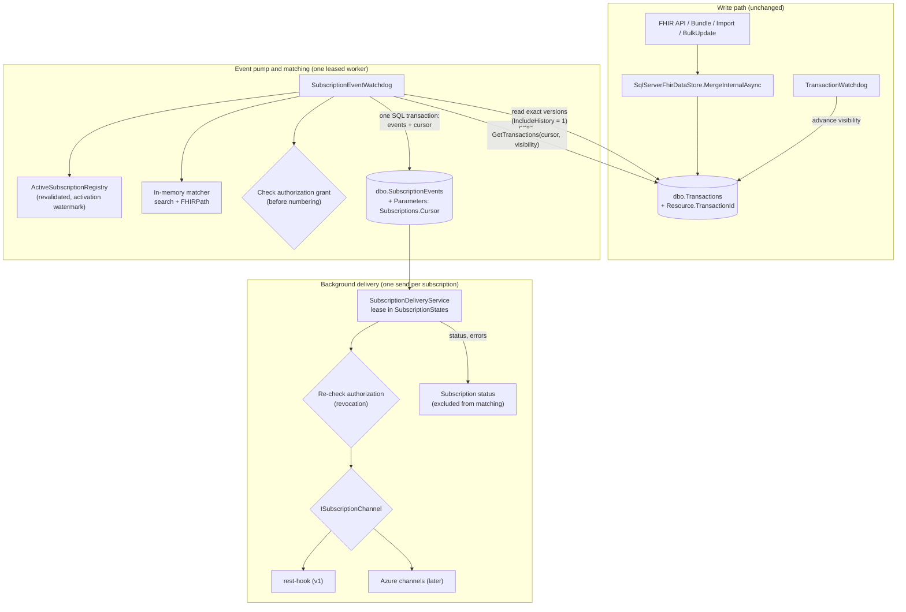

# Proposal: FHIR Subscriptions and Notifications

Labels: [SQL](https://github.com/microsoft/fhir-server/labels/Area-SQL), New-Feature

Status: Draft proposal. [ADR-2611: FHIR Topic-Based Subscriptions](../adr-2611-fhir-subscriptions.md) records the proposed decision. This document gives the scope, design and release gate. The ADR and this proposal are reviewed before any feature code. The code PR adds the user guide and example requests.

## 1. Purpose and scope

This proposal adds FHIR topic-based subscriptions to the Microsoft FHIR Server. Clients can request notifications when resources change. It covers:

1. The subscription features the FHIR specification defines, and which ones we will implement ([section 3](#3-feature-support-matrix)).
2. What we will explicitly **not** implement, and why ([section 4](#4-not-implementing)).
3. How the feature uses existing server components, the design, release gate and code placement ([sections 5-8](#5-existing-eventing-architecture)).
4. The impact on the managed Azure Health Data Services events capability ([section 9](#9-impact-on-azure-health-data-services-events)).

FHIR specification references:

- FHIR R5 [Topic-Based Subscriptions Framework](https://hl7.org/fhir/R5/subscriptions.html), [Subscription](https://hl7.org/fhir/R5/subscription.html), [SubscriptionTopic](https://hl7.org/fhir/R5/subscriptiontopic.html), [SubscriptionStatus](https://hl7.org/fhir/R5/subscriptionstatus.html)
- [Subscriptions R5 Backport IG](https://hl7.org/fhir/uv/subscriptions-backport/) (for R4 and R4B)
- FHIR R4 [Subscription](https://hl7.org/fhir/R4/subscription.html) (base resource for Backport profiles; classic criteria-based use is not supported)

## 2. FHIR Subscriptions in brief

The framework has three parts:

| Component | Role |
|---|---|
| `SubscriptionTopic` | Defines what triggers a notification, which filters clients may apply, and which related resources to include. Subscriptions reference it by canonical URL. |
| `Subscription` | A client's request for notifications on one topic. It sets the filters, the **channel** (rest-hook, websocket, email, message, or custom), the endpoint, and the **payload** (MIME type plus `empty` / `id-only` / `full-resource`). |
| Notification `Bundle` | A `history` Bundle on R4/R4B, or a `subscription-notification` Bundle on R5. The first entry gives the subscription status, followed by any event payloads. |

How each FHIR version expresses these:

| FHIR version | `Subscription` | Topic | Status in notifications |
|---|---|---|---|
| **R4** | R4 `Subscription` + Backport IG extensions (`criteria` = topic canonical) | **Not a resource type in R4.** The IG leaves topic definition out of scope. This server represents topics as `Basic` resources (see 3.2). | `Parameters` (backport-subscription-status profile) |
| **R4B** | R4B `Subscription` + Backport IG extensions | `SubscriptionTopic` resource | `SubscriptionStatus` resource |
| **R5** | Native `Subscription` (`topic`, `filterBy`, `channelType`, `content`, ...) | `SubscriptionTopic` resource | `SubscriptionStatus` resource |
| R4 (classic, **not supported**) | R4 `Subscription` with `criteria` = search URL | None | None. The payload is empty or the resource itself. |

The managed Azure Health Data Services FHIR service runs R4 (4.0.x) and STU3, not R4B ([FAQ](https://learn.microsoft.com/azure/healthcare-apis/fhir/fhir-faq)). **R4 with the Backport IG is therefore the primary target**, and API-defined topics must work on R4.

**Minimum required support** (R5 §3.9.7 and Backport IG conformance for R4B):

- `Subscription`: read and write. Search is recommended.
- The `$status` operation.
- `SubscriptionTopic`: read and search.
- At least one channel type (preferably a core one) and at least one payload type.

On **R4**, the Backport IG does not require `SubscriptionTopic` read/search, because R4 has no such resource. It recommends topic discovery through the CapabilityStatement topic-canonical extension. The API-defined R4 topics in 3.2 are a server-specific extension.

Delivery is **best-effort** unless a channel defines otherwise. Clients use event numbers and heartbeats to detect numbered gaps. In v1, `$status` reports status and counts; clients re-query resources to recover. `$events` replay is planned for later. Changes lost at the source may have no event number and cannot always be detected this way.

## 3. Feature support matrix

Legend:

- ✅ **v1**: in the first release (see the [release gate](#7-v1-release-gate)).
- ⏳ **Later**: planned after v1.
- ❌ **No**: not planned (see [section 4](#4-not-implementing)).

### 3.1 FHIR versions and subscription models

| Feature | Spec | Support |
|---|---|---|
| R5 topic-based subscriptions | Core R5 | ✅ v1 |
| R4B topic-based (Backport IG) | Backport IG | ✅ v1 |
| R4 topic-based (Backport IG) | Backport IG | ✅ v1 |
| R4 classic criteria-based (`Subscription.criteria` = search URL) | Core R4 | ❌ No. Rejected at create; only Backport-profiled R4 subscriptions are accepted. |
| STU3 subscriptions | Core STU3 | ❌ No |

### 3.2 SubscriptionTopic

| Feature | Spec | Support |
|---|---|---|
| Create, read, update, delete and search topics **through the API**, on all supported versions | SHALL read/search; write is MAY | ✅ v1. **Required.** Writes need the new `SubscriptionTopic` permission (3.7). Topics are rejected if any trigger or filter is unsupported. |
| R4B/R5: native `SubscriptionTopic` resource | Core | ✅ v1 |
| R4: topic as a `Basic` resource with `Basic.code` = `http://hl7.org/fhir/fhir-types#SubscriptionTopic`, with topic elements as extensions (searchable as `Basic?code=http://hl7.org/fhir/fhir-types\|SubscriptionTopic`) | Server-specific. The IG leaves R4 topic definitions out of scope and records that HL7 dropped an earlier `Basic` profile because it was difficult to use. | ✅ v1. The server ships a `StructureDefinition` for this profile (`http://fhir.microsoft.com/StructureDefinition/subscription-topic-basic`), lists it in `Basic.supportedProfile`, and resolves it for `$validate` without an upload. The extension layout follows HAPI FHIR: metadata uses `5.0` URLs, `status` is a modifier extension, and `resourceTrigger`/`canFilterBy` use `4.3` URLs. The earlier all-`5.0` layout is also accepted. This does not guarantee compatibility with every server. |
| Topics pre-loaded from configuration or packages (for example, IG-defined topics) | Backport IG | ⏳ Later |
| CapabilityStatement topic advertisement (`capabilitystatement-subscriptiontopic-canonical` extension) | MAY | ✅ v1 |
| `resourceTrigger.resource`, including multi-resource and `Resource` topics | Core | ✅ v1 |
| `resourceTrigger.supportedInteraction` create / update / delete | Core | ✅ v1. Delete means **soft delete** (see 4). |
| `resourceTrigger.queryCriteria` (`current`, `previous`, `resultForCreate`, `resultForDelete`, `requireBoth`) | Core | ✅ v1. Limited to the filter subset in 3.4. |
| `resourceTrigger.fhirPathCriteria` (`%current`, `%previous`) | Core | ✅ v1 |
| `canFilterBy` (`resource`, `filterParameter`, `comparator`, `modifier`) | Core | ✅ v1 |
| `notificationShape.include` / `revInclude` | Core | ⏳ Later |
| `eventTrigger` (non-REST business events) | Core | ❌ No |
| Topic versioning, `derivedFrom` resolution | Core | ⏳ Later |

### 3.3 Subscription

| Feature | Spec | Support |
|---|---|---|
| Create, read, update, delete, search `Subscription` | SHALL read/write, SHOULD search | ✅ v1 |
| Validation at create or update (topic, filters, channel, endpoint, payload), returning `OperationOutcome` on rejection | SHOULD | ✅ v1 |
| `status` lifecycle: `requested` → `active` → `error` / `off`; `entered-in-error` | Core | ✅ v1. Only the server sets `active` or `error`. Clients may request activation or retry with `requested`, or stop with `off` or `entered-in-error`. See 3.6. |
| `filterBy` (R5) / `backport-filter-criteria` extension (R4/R4B) | Core / IG | ✅ v1. Uses the subset in 3.4. |
| `end` (auto-deactivate) | Core | ✅ v1 |
| `heartbeatPeriod` | Core | ✅ v1. Server enforces a minimum. |
| `timeout` | Core | ✅ v1. Capped by server configuration. |
| `maxCount` (multiple events per notification) | Core | ✅ v1. Capped by server configuration. |
| `contentType` `application/fhir+json`, `application/fhir+xml` | Core | ✅ v1 |
| `content` / `backport-payload-content`: `empty`, `id-only`, `full-resource` | SHALL ≥1 | ✅ v1. **`id-only` is the default.** The Backport profile requires the content extension (1..1). If it is missing, the server adds `id-only` and returns the accepted value. |
| `fhirVersion` MIME parameter other than the server's version | SHALL NOT accept if unsupported | ❌ No. Rejected at create. |
| `parameter` (R5) / `channel.header` (R4/R4B) as HTTP headers | Core | ✅ v1. Values are not logged. Redaction on read remains an open policy question (section 10). |
| `managingEntity`, `contact`, `reason`, `name`, `identifier` | Core | ✅ Stored only; no behaviour. |

### 3.4 Filter and criteria evaluation

Filters and criteria are evaluated **in memory** against the changed resource (and its previous version), using the server's existing search parameter definitions.

| Feature | Support |
|---|---|
| Search parameter types: token, string, reference, date, number, quantity, uri | ✅ v1 |
| Comparators `eq`, `ne`, `gt`, `lt`, `ge`, `le`, `sa`, `eb`, `ap` (where valid for the type) | ✅ v1 |
| Modifiers `:missing`, `:exact`, `:contains`, `:not`, `:text` (token) | ✅ v1 |
| Custom search parameters (`SearchParameter` resources in the `Supported`/`Enabled` state) | ✅ v1 |
| Composite search parameters | ⏳ Later |
| Chained parameters, reverse chaining (`_has`), `_include` in criteria | ❌ No. These need database queries and are rejected when written. |
| `:above` / `:below` / `:in` / `:not-in` (terminology) | ❌ No. Rejected at create. |
| `_text`, `_content`, `_filter`, `_query`, semantic search | ❌ No. Rejected at create. |

### 3.5 Channels

| Channel | Spec | Support |
|---|---|---|
| `rest-hook` (HTTPS POST of the notification Bundle) | Core | ✅ v1 |
| Custom Azure channels: Event Grid, Service Bus, Storage (custom `channelType` codes, Managed Identity) | Allowed (custom codes) | ⏳ Later |
| `websocket` (+ `$get-ws-binding-token`) | Core | ❌ No |
| `email` | Core | ❌ No |
| `message` (FHIR Messaging Bundle) | Core | ❌ No |

### 3.6 Notifications, lifecycle and operations

| Feature | Spec | Support |
|---|---|---|
| `event-notification` | Core | ✅ v1 |
| `handshake` on activation | **SHALL** for rest-hook (R5 and Backport) | ✅ v1. **Mandatory, not configurable.** A new or re-requested rest-hook subscription stays `requested` until a handshake is accepted (2xx), then becomes `active`. A failed initial handshake sets `error`. |
| `heartbeat` | Core | ✅ v1 |
| `query-status` via `$status` (instance and type level) | **SHALL** | ✅ v1 |
| `query-event` via `$events` (replay past events) | MAY | ⏳ Later. Limited to the server's retention window. |
| `eventsSinceSubscriptionStart` / `notificationEvent.eventNumber` (gap detection) | Core | ✅ v1. Numbers increase per subscription and are assigned after authorization (3.7). Recorded `Unevaluable` events take a number but are not sent. Missing source rows and changes that cannot be authorized leave no numbered gap (decision 3). |
| `notificationEvent.focus` (absent for `empty`); for `id-only`, each entry carries `fullUrl` and `request`; for `full-resource`, each entry carries the resource, or `request`/`response` when it cannot be included | Core / Backport payloads | ✅ v1. Checked by profile validation in the release gate. |
| `notificationEvent.additionalContext` | Core | ⏳ Later, with `notificationShape`. |
| `SubscriptionStatus.error` reporting | Core | ✅ v1 |
| Error handling: bounded retries with back-off, then `error`; persistent failure, then `off`; client resets to `requested` | SHOULD | ✅ v1. Pending events stay in storage while in `error`; `EventRetentionDays` does not remove them. A client can request a new handshake to retry. After `MaxErrorHours` (default 72), the server sets `off` and discards pending events. `0` disables this limit. |
| Ordered dispatch per subscription | Not required | ✅ v1. **One notification at a time per subscription.** After retries are exhausted, delivery pauses in `error`. Later events cannot pass the failed event. A failing endpoint blocks only its own subscription. |
| Stored, retried delivery attempts with stable event numbers | Best-effort required | ✅ v1. A retry reuses the same `eventNumber`. Receipt is not guaranteed. Clients remove duplicates by event number. |
| Guaranteed (reliable) channel semantics | Optional | ❌ No |

### 3.7 Security

| Feature | Spec | Support |
|---|---|---|
| **Authorization on API writes.** On create or update, the server records the caller's identity, roles, SMART scopes and compartment in an authorization grant. The caller needs read access to each topic resource type. Per-event checks also enforce resource-level restrictions, including the patient compartment. | SHALL enforce policy | ✅ v1 |
| **Authorization for every event and content level**, including retries and status counts. The server checks the stored grant before assigning an event number. Changes outside the grant are not numbered or sent (R5 §3.9.8). Delivery checks again for local revocation; this later denial may leave a gap. | SHOULD ensure authorization is still in place | ✅ v1. The grant cannot detect identity-provider revocation. Local controls are stopping or deleting the subscription, limiting its lifetime through `end`, and checking current server roles. Renewal through the API captures a fresh grant. |
| New `DataActions.SubscriptionTopic` permission. It is required whenever **either the existing or the new** resource is a topic (the R4B/R5 `SubscriptionTopic`, or an R4 `Basic` with the topic code), covering create, update, delete and conditional variants. Reading and searching topics needs only `Read`. | Server policy | ✅ v1. Mirrors the existing `DataActions.SearchParameter` pattern. `DataActions.All` must be extended to include it. |
| **Validation when loading stored resources.** `$import` and bulk update bypass API validation. The registry therefore validates topics and subscriptions again before use. Activation needs valid content and a server-owned grant bound to the accepted content and endpoint (decision 8). Missing or invalid grants prevent handshakes and notifications. The server corrects status to `off` or `error` and reports the reason through `$status`. Stored status may be stale until background validation runs. | Server policy | ✅ v1. Blocks imported subscriptions from bypassing endpoint checks or authorization. |
| HTTPS-only endpoints, a configurable endpoint allow-list, and blocking of private and link-local addresses | Recommended | ✅ v1 |
| Restricting `full-resource` per client or role beyond the normal event authorization checks | MAY | ⏳ Later. No setting implements this policy in v1. |
| Tracking sent notifications as `AuditEvent`/`Communication` resources | Encouraged | ❌ No. Uses the server's existing audit logging and telemetry instead. |

### 3.8 Change sources that trigger notifications

| Source | Support |
|---|---|
| REST create, update, patch, soft delete, and conditional variants | ✅ v1 |
| Batch and transaction bundles (only committed entries notify) | ✅ v1 |
| `$import`, bulk update, bulk (soft) delete | ✅ v1. Long batches delay all notifications. Imported historical versions notify only with `NotifyHistoricalVersions=true` and the `Transactions` source. Stored topics and subscriptions are validated again before use (3.7). Source and history limits are in section 6. |
| Server-originated `Subscription` bookkeeping (status, error and event-count updates) | ❌ No. Excluded from matching to prevent notification loops. |
| Hard delete (`_hardDelete`), `$purge-history` | ❌ No |
| Cosmos DB data store | ❌ No |

## 4. Not implementing

| Item | Reason |
|---|---|
| **`eventTrigger` topics** | Requires a business-event model the server doesn't have. Only resource changes are observable. |
| **R4 classic criteria-based subscriptions** (`Subscription.criteria` = search URL, R4 `channel.payload` semantics, `sms` channel) | Superseded by topic-based subscriptions (the R5 framework and the Backport IG). Supporting both models doubles the validation and notification formats. R4 `Subscription` resources without the Backport profile are rejected with `OperationOutcome`. |
| **websocket, email, message channels**, `$get-ws-binding-token` | Each needs new connection-management or infrastructure (persistent sockets across instances, SMTP, messaging endpoints) with limited demand. rest-hook plus Azure-native channels cover the integration scenarios. Can be revisited as separate proposals. |
| **Guaranteed or exactly-once delivery** | The spec defines best-effort delivery. We provide durable, retried attempts with stable event numbers, ordered dispatch and gap detection. |
| **Cross-version notifications** (`fhirVersion` MIME parameter ≠ server version) | Each server instance runs one FHIR version. Requests are rejected at create, as the spec requires. |
| **Database-evaluated criteria** (chained, `_has`, terminology modifiers, `_filter`, full-text, semantic) | Avoids a database query per event per subscription. Unsupported criteria are rejected when written, not silently ignored. |
| **R4 topics in a non-`Basic` form** (for example, an R4B-shaped `/SubscriptionTopic` endpoint on an R4 server) | `Basic` keeps R4 topics as valid R4 resources that work with the existing REST, search, history and authorization, without a non-standard endpoint. |
| **Hard delete and `$purge-history` notifications** | Data is physically removed, and the current schema doesn't expose those keys to the event source. This matches the Azure Health Data Services events contract (section 9). |
| **Cosmos DB** | No ordered transaction log equivalent exists. It would need a separate change-feed design. |
| **STU3** | The framework isn't defined for STU3, and there is low demand. |
| **`AuditEvent` per notification** | Volume. Existing audit logging is used. |
| **Backfill / trigger operations** (not in the spec) | Non-standard. They may be proposed later as a server extension. |

## 5. Existing eventing architecture

The design builds on the following server components. New subscription components are described in section 6.

| Building block | Location | Relevance |
|---|---|---|
| **Transactions table + visibility watermark** (SQL) | `Features/Schema/Sql/Tables/Transactions.sql`; stored procedures `MergeResourcesBeginTransaction`, `MergeResourcesCommitTransaction`, `MergeResourcesAdvanceTransactionVisibility`, `MergeResourcesGetTransactionVisibility`, `GetTransactions`, `GetResourcesByTransactionId` | SQL writes through `SqlServerFhirDataStore.MergeInternalAsync` open a transaction row. Each `Resource` row records its `TransactionId`. `TransactionWatchdog` advances visibility only when earlier transactions have completed and completes timed-out transactions. IDs are assigned at transaction start, not commit. Clock changes and missing history limit event coverage (section 6). |
| **EventsReader POC** | `tools/EventsReader/Program.cs` | Demonstrates the polling shape: poll the watermark, call `GetTransactions(last, current)`, read keys per transaction, and persist a cursor in `dbo.Parameters`. **It is not a correct reader to copy.** `GetTransactions` returns at most 10,000 rows, but the POC checkpoints the *visibility watermark* rather than the last transaction it processed, so a backlog over one page is skipped. It also has no crash-consistency between processing and checkpointing. |
| **Resource change capture** (SQL) | `ResourceChangeData` table, `CaptureResourceIdsForChanges`, `FetchResourceChanges_3`, `SqlServerFhirResourceChangeDataStore : IChangeFeedSource<ResourceChangeData>` | Controlled by `CoreFeatureConfiguration.SupportsResourceChangeCapture` (default `false`). It records create, update and soft delete from `MergeResources`, but not hard delete. The new subscription source can read it. The managed events publisher is not in this repository and is presumed to use this feed (section 9). |
| **MediatR request pipeline** | `Shared.Core/Features/Resources/*` handlers, `IPipelineBehavior<>` (for example `CreateOrUpdateSearchParameterBehavior`) | The place to **validate** `Subscription` and `SubscriptionTopic` writes. Not suitable for emitting events: it runs before commit and is bypassed by import and bulk jobs. |
| **Stored job queue** | `Microsoft.Health.TaskManagement` (`JobHosting`, `IJobFactory`, `IQueueClient`), `JobType`/`QueueType` | Supports background jobs with retries and heartbeats. Earlier subscription prototypes used it; this design uses a watchdog and delivery service instead. |
| **Watchdogs** | `SqlServer/Features/Watchdogs` (`Watchdog<T>`, `WatchdogLease`) | A lease allows one instance at a time to run periodic work. |
| **Search stack** | `ISearchIndexer`, `ISearchOptionsFactory`, `Features/Search/Expressions`, `IFhirPathProvider` | Parses criteria and indexes a resource in memory. The subscription feature adds an evaluator that reuses these components. |
| **Cross-instance cache sync** | ADR `adr-2603-load-independent-search-param-cache-sync.md` | A pattern for a shared active-subscription registry. |

**Gaps:**

- **Hard delete and `$purge-history`** use `HardDeleteResource.sql`. They open a `Transactions` row only when change capture is on, and even then they tag rows with `HistoryTransactionId`, so `GetResourcesByTransactionId` does not return them.
- **Cosmos DB** has no ordered transaction log.
- **Historical rows.** Reading only `@IncludeHistory = 0` loses versions updated again before matching. The earlier prototype had this defect. The new source includes historical rows that still exist.
- **Previous version.** `queryCriteria.previous` and `%previous` need the prior version. `InvisibleHistoryCleanupWatchdog` may remove it.
- **Delays from incomplete transactions.** `MergeResourcesAdvanceTransactionVisibility` stops at the oldest incomplete transaction. A long `$import` batch, or a stalled transaction until `TransactionWatchdog` times it out (6 × heartbeat period), delays every subscription.

**Prior work:** closed PRs #4474, #4628 and #5478 used a transaction watchdog, matching and delivery jobs, several channels, and an R4 Backport converter. This design reuses the pump and converter approach, but matches in the pump and delivers through a background service, not queued jobs. Section 11 records the known outcomes and inferred causes.

## 6. Implementation design

### Event source options

Two sources implement `ITransactionEventSource`. Both read existing data without changing it. The change-feed source maps each record to its writing transaction, so both sources use the same event uniqueness key and activation watermark. Each source has its own cursor. The source is fixed on first use of a database (section 12).

| | `Transactions` (preferred) | `ResourceChangeData` change feed (alternative) |
|---|---|---|
| Availability | Written on every SQL write | Only when `SupportsResourceChangeCapture` is on |
| Added write cost | None | One insert inside every write, if capture is not already on |
| Ordering for readers | Visibility watermark (consistent order; IDs are allocated at transaction begin, so not strictly commit order); no new locks on writes | Identity order; the existing reader holds a `TABLOCK, HOLDLOCK` that can block concurrent writes (impact not measured) |
| Retention | Can be held back by the subscription cursor | Not managed in this repository; presumed owned by the managed events pipeline (unverified). A lagging reader could lose events |
| Coverage | Create, update, soft delete, `$import`, bulk, including historical versions loaded by `$import` | Same, except historical versions (only `IsHistory = 0` rows are captured) |
| Main drawback | Long transactions delay every subscription | Table locks and dependence on managed events configuration |

The product group must confirm the default source before accepting ADR-2611. It must also decide whether imported history should notify and whether change capture and its retention are supported dependencies. Settings control the source and imported-history behaviour, but do not by themselves establish a retention guarantee.

### Proposed design decisions

1. **Event source is `Transactions`** (preferred; see the options above). It is always on, consistently ordered, and covers import and bulk operations. `ResourceChangeData` is not modified (section 9); it remains the documented alternative.
2. **Cursor and replay.**
   - The cursor records the last source position whose matching results were committed. It is not advanced to an unread visibility watermark. The pump reads successive pages, including backlogs larger than 10,000 transactions.
   - Matching output (`SubscriptionEvents` rows) and the cursor advance are written in **one SQL transaction**. A crash before commit replays the batch; a crash after commit does not.
   - `SubscriptionEvents` has a unique key on `(SubscriptionId, TransactionId, ResourceTypeId, ResourceSurrogateId)`, so a replayed batch cannot create duplicate events or consume extra event numbers. This guarantees one **logical** event per match; it does not prevent the same notification being delivered more than once (decision 7).
   - Required tests: a backlog of more than 10,000 transactions, and a process kill between matching and commit.
3. **Exact versions and history limits.** The `Transactions` source reads every version a page of transactions wrote, including history, in one `GetResourcesByTransactionIdRange` call, and matches the exact version when available. `previous` criteria use the immediately preceding version. If a change record remains but a required version is missing, the pump can record `Unevaluable`. The topic must cover that change, and the grant must allow reading the resource type without compartment or search-parameter scope restrictions. Restricted subscribers get no numbered gap because it could reveal a change they cannot read. A recorded `Unevaluable` event takes a number but is not delivered; `$status` and metrics report the failure.
   - When history is disabled, a later write can replace the earlier body with an invisible marker or delete the row. A marker can produce `Unevaluable`; a deleted change row cannot be reported. A numbered gap is therefore not guaranteed.
   - `UnversionedResourceTypes=AllowWithGaps` permits topics on `no-version` types with these limits. `RequireHistory` rejects such topics, including base-type triggers while any covered type is `no-version`. It does not prevent all missing-history cases.
   - While enabled, the feature keeps invisible history for at least `MaxHistoryCleanupHoldHours` (default 24). Cleanup does not wait for the pump cursor. A longer backlog can lose required versions or change rows.
   - Imported historical versions notify only with `NotifyHistoricalVersions=true`. The change feed does not record them.
   - Required test: rapid updates with history disabled, with change capture both on and off.
4. **Activation and ordering.** After a successful handshake, the server records `ActivationTransactionId`. Matching uses that watermark with the `TransactionReadLagSeconds` margin (default 5), so changes shortly before activation may notify.
   - Transaction IDs use the SQL Server clock. A backward clock step can place a later transaction below the saved cursor. The `Transactions` source delays reads by the configured margin to reduce this risk.
   - A transaction that commits below a cursor already passed is counted in `Subscriptions.LateTransactions` and logged, but not notified. An ordinary long transaction delays visibility; exceeding the read delay alone does not make it late.
   - On first run, the pump starts at visibility, or the earliest existing activation watermark if lower.
5. **In-memory matching** through a new evaluator in `Core/Features/Search/InMemory`, reusing `ISearchIndexer`/`ISearchOptionsFactory` and `IFhirPathProvider`. Unsupported criteria are rejected when the subscription or topic is written (3.4).
6. **Stored events and state.** `dbo.SubscriptionEvents` stores event numbers, resource versions, interactions, delivery status and retry details. `dbo.SubscriptionStates` stores grants, accepted content hashes, activation watermarks, event counters, errors and delivery leases. Delivered and other completed event records expire after `EventRetentionDays`. Pending events do not expire under that setting.
7. **One send at a time.** A hosted background service delivers notifications, not a `TaskManagement` job. A per-subscription lease prevents concurrent sends and is renewed before each send for longer than its timeout. Retry exhaustion sets `error` and pauses delivery. After `MaxErrorHours` (default 72), the server sets `off` and retires pending events; `0` disables the limit.
8. **Registry and grants.** Each instance caches subscriptions and topics and refreshes the cache after changes and on a timer. It validates stored content again before use. Activation requires a server-owned authorization grant bound to the accepted content hash and endpoint, not merely a stored `active` status.
   - Changed content needs a new grant and handshake. Old pending events are retired so they cannot reach a new endpoint or use new filters.
   - `off`, `entered-in-error`, deletion and expiry revoke the grant. Writes outside the API cannot create a new grant.
   - Without a valid grant, no handshake or notification is sent. The server corrects stored status to `off` or `error` during background validation; raw resource reads may show stale status until then.
   - Each activation increments a counter. If activation changes while the pump matches a page, the page is matched again rather than committed with missing subscriptions.
9. **Loop prevention.** Writes the subscription engine makes to `Subscription` resources (status, error, event counts) are tagged and excluded from matching.
10. **Canonical internal model.** An R5-shaped internal model is used for all versions, with converters for R4 Backport, R4B and R5, following the Backport IG recommendation to use R5 definitions internally. On R4, `SubscriptionTopic` is converted to and from `Basic` (topic code plus extensions).
11. **Opt-in.** `FhirServer:Subscriptions:Enabled` defaults to `false` and is independent of `SupportsResourceChangeCapture`. The feature needs SQL Server schema 123 or later. Subscription and topic API writes need validation and grant handling; matching and delivery add no synchronous step to other resource writes.

## 7. v1 release gate

v1 ships only when all of these pass:

- ADR-2611 is accepted, including the product group decisions on its open defaults.
- Measurements on representative data record pump throughput, added database load, and notification delays during a long `$import`. A latency target is set from these results.
- An R4 Backport flow works end to end: create an API-defined topic (R4 `Basic`) with `DataActions.SubscriptionTopic`; create an `id-only` rest-hook subscription and confirm the server adds the content extension; complete the handshake (`requested` → `active`); deliver one authorized event. Repeat with the worker stopped mid-batch (readable changes replay without duplicate event numbers), and with authorization revoked between matching and delivery (event not sent).
- E2E tests against a local webhook receiver for R4 Backport, R4B and R5 payloads (`Parameters` vs `SubscriptionStatus` as the first entry), validated against the Backport and R5 profiles, for every content level (`empty` has no focus; `id-only` entries carry `fullUrl` and `request`).
- Handshake transitions: success → `active`; failure → `error`.
- Backlog over 10,000 transactions and crash-replay tests pass.
- Load test (`tools/PerfTester`) results, including notification delays during `$import`, meet the latency target.
- Regression tests with `Subscriptions:Enabled=false`, and with both subscriptions and `SupportsResourceChangeCapture` enabled, show no change to existing behaviour.
- A user guide (`docs/Subscriptions.md`) documents settings, defaults, metrics, the R4 topic profile and limits. Example requests (`docs/rest/Subscriptions.http`) and a local sample are included.

## 8. Code placement

| Component | Project |
|---|---|
| Configuration, `ISubscriptionChannel`, `ITransactionEventSource`, in-memory evaluator, registry, delivery service, authorization grant and subscription validation | `Microsoft.Health.Fhir.Core` |
| Version converters, notification Bundle builder | `Microsoft.Health.Fhir.Shared.Core` |
| `$status` endpoint and API registration (`$events` later) | `Microsoft.Health.Fhir.Shared.Api` |
| Event watchdog, SQL event sources, `SubscriptionEvents` and `SubscriptionStates` tables, stored procedures | `Microsoft.Health.Fhir.SqlServer` |

## 9. Impact on Azure Health Data Services events

[Azure Health Data Services events](https://learn.microsoft.com/azure/healthcare-apis/events/events-overview) is a managed capability. It publishes `FhirResourceCreated`, `FhirResourceUpdated`, and `FhirResourceDeleted` (soft delete only) to an Event Grid system topic. Customers can filter events, and delivery includes retries, dead-lettering, and at-least-once semantics. The [FAQ](https://learn.microsoft.com/azure/healthcare-apis/events/events-faqs) states that events are not ordered within bundles, are not emitted for failed transaction bundles, and are capped at 5,000 events per second per workspace. The publisher is not in this repository. The OSS server exposes `ResourceChangeData` through `IChangeFeedSource<ResourceChangeData>` when `SupportsResourceChangeCapture` is on, and the managed pipeline is presumed to consume it. The internal implementation must confirm this assumption before the ADR is accepted.

| Aspect | Azure Health Data Services events | This proposal |
|---|---|---|
| Purpose | Azure integration events for supported resource changes | FHIR-standard, client-managed subscriptions with server-side filtering |
| Configured by | Azure control plane (Event Grid subscription, ARM/RBAC) | FHIR API (`POST Subscription`), FHIR authorization and SMART scopes |
| Filtering | Event Grid filters on event type and metadata | FHIR search criteria, `SubscriptionTopic` triggers, `filterBy`, FHIRPath |
| Payload | Event Grid schema: resource type, ID, version, account; no resource body | FHIR notification Bundle with `Parameters` status on R4 or `SubscriptionStatus` on R4B/R5; `empty`, `id-only` or `full-resource` content |
| Source | `ResourceChangeData` (presumed) | `Transactions` + `Resource.TransactionId` (preferred); `ResourceChangeData` as a read-only alternative (section 6) |
| Ordering / replay | No ordering guarantee; no replay of past changes | Ordered dispatch by `eventNumber` per subscription; undelivered events retained; `$events` replay post-v1 |

**Required rules (no behaviour change for existing events):**

1. **No schema or contract changes** to `ResourceChangeData`, `ResourceChangeType`, `CaptureResourceIdsForChanges`, `FetchResourceChanges_3`, the partitioning stored procedures, or `SqlServerFhirResourceChangeDataStore`. New storage adds `SubscriptionEvents`, `SubscriptionStates` and keys in `dbo.Parameters`.
2. **`SupportsResourceChangeCapture` stays independent** of the new `Subscriptions:Enabled` flag. Either can be on without the other.
3. **No synchronous matching or delivery is added to other resource writes.** Subscription and topic API writes still need validation and grant handling. Background work adds shared database load, which must be measured. Only committed changes can notify; failed transaction bundles do not notify.
4. **Hard-delete semantics are unchanged.** Hard delete stays out of both feeds in v1.

**Shared costs to monitor when both are enabled:**

- Additional reads against `Transactions` and `Resource` from the matching job, plus `SubscriptionEvents` writes. Measure these against the database budget alongside the `ResourceChangeData` writes, which are made inside `MergeResources`.
- Additional history storage from `MaxHistoryCleanupHoldHours`. Exact-version matching needs history, but cleanup does not wait for the subscription cursor (decision 3).

**Product positioning:**

- Present the features as complementary. Events distribute supported resource changes through Azure. Subscriptions provide FHIR-standard, client-managed filters, including for Da Vinci or Backport IG clients.
- The proposed Azure Event Grid channel (post-v1) sends FHIR notification Bundles to a customer-owned topic. It must not reuse the `Microsoft.HealthcareApis.*` event types, to avoid confusion with system-topic events.
- A separate ADR could evaluate moving the managed events publisher to a transaction-based pump. It would need to address clock and history limits and would not by itself add hard-delete coverage (section 5). That work is outside this proposal.

## 10. Risks and open questions

- **Event source.** `Transactions` (preferred) or the `ResourceChangeData` change feed (section 6). Both are implemented and `EventSource` selects one; awaiting product group guidance on the default.
- **Throughput.** One leased pump performs matching. `MaxActiveSubscriptions` caps subscriptions, but the default has not been measured on a representative deployment. The release gate requires a throughput measurement. Consider parallel matching within a batch or separate pumps by resource type only if results require them.
- **Notification delay.** Long `$import` batches or stalled transactions delay all notifications (section 5). Set a latency target. Historical import behaviour is controlled by `NotifyHistoricalVersions`; there is no per-operation opt-out in v1.
- **Storage load.** Each match adds a `SubscriptionEvents` row. Event cleanup and database load must be checked before release.
- **History retention.** The fixed history hold can increase storage, but does not guarantee recovery after a longer backlog. Missing source rows may produce no numbered gap. Confirm the default `UnversionedResourceTypes` policy (decision 3).
- **Authorization snapshot limits.** Snapshot-based checks cannot see identity-provider revocation. Decide the default maximum subscription lifetime (`MaxLifetimeDays`, currently 365), and whether certain roles may hold longer-lived subscriptions.
- **Header secrets on read.** The spec says `Subscription` is not secret storage. Header values are not logged, but redaction on read is not implemented. Decide whether readers without write permission should see them.
- **Topic deletion and updates with active subscriptions.** Decide whether to reject topic deletion while subscriptions reference the topic, and whether trigger changes require subscriptions to be re-requested.

## 11. Lessons from prior attempts and delivery guardrails

### 11.1 What happened

None of the earlier PRs was rejected in review. None received human review comments; the only reviewer activity was automated CodeQL findings. No closing rationale was recorded beyond "We will reopen the PR" on #4474. They stalled and were closed:

| PR | Size | Outcome | Observed issues |
|---|---|---|---|
| #4474 "Subscription Feature" (Aug 2024) | +3,761 / 93 files | Draft. Closed after three weeks with "We will reopen the PR". | Superseded by #4628 from the same branch. Template description left unfilled. CodeQL reported 20+ potential problems. |
| #4628 "[Feature] Subscriptions engine" (Sep 2024) | +3,688 / 81 files | Marked ready for review, then sat **six months with no review**. Closed without comment in Apr 2025. | Single large PR spanning a new project, Core, Api, SqlServer, the job framework and search. No ADR or linked issue. Template description unfilled. Depended on unmerged #3814 when opened. No recorded CI result. CodeQL 20+ findings. |
| #5478 "[DO NOT REVIEW] Add subscriptions and SqlonFhir View Definitions" (Mar 2026) | +81,063 / 235 files | Closed by the author in Oct 2026. | Explicitly a demo branch (the plan targeted a DevDays 2026 presentation). It combined subscriptions with SQL-on-FHIR, a new SDK, and a Parquet/Fabric materializer. The `Check Metadata` validation was failing. Not intended for merge. |

**Likely root causes.** These are inferred, because no closing rationale was recorded:

1. **No agreed design up front.** None of the PRs had an accepted ADR or a scope statement. Reviewers had to assess architecture, scope and code in one pass.
2. **PRs too large to review**, touching many layers, plus the storage schema, in one change.
3. **Scope coupling.** Subscriptions were bundled with unrelated features (#5478) or with unmerged prerequisites (#4628).
4. **No visible reviewer assignment or linked work item.** Whether this reflected missing ownership or a priority decision is not recorded.
5. **Prototype-level quality signals:** unfilled template, CodeQL findings, incomplete tests ("functional but limited test coverage" per the #5478 plan), and no performance evidence for the write-path-adjacent design.

Related work did merge: the watchdog cleanup (#3814), and FHIRPath engine work under [ADR-2608](../adr-2608-ignixa-sdk-migration.md), including #5801. These examples support agreeing the design and keeping changes focused, but do not prove why the subscription PRs stalled.

### 11.2 Guardrails for this effort

| # | Guardrail | Addresses |
|---|---|---|
| 1 | **ADR first.** [ADR-2611](../adr-2611-fhir-subscriptions.md) records the decision and must be **accepted by maintainers before feature code is opened for review.** It fixes the scope in sections 3-4 and the decisions in section 6. Code PRs link to the ADR. | 1 |
| 2 | **One feature PR.** The feature is disabled by default. Group commits by component (schema, event pump, resources and validation, matching, delivery), keep the schema migration in a separate commit, and link each part to its design and tests. | 2 |
| 3 | **Strict scope.** Only subscriptions. SQL-on-FHIR, analytics materialization, and new channels beyond v1 are separate proposals. Prerequisites (for example, the in-memory evaluator, or the `DataActions.SubscriptionTopic` permission) merge first as standalone PRs with their own value and tests. | 3 |
| 4 | **Ownership.** A tracking issue or work item with an owner, a named maintainer reviewer, and a milestone. PRs carry the required labels and milestone so `Check Metadata` passes. A PR left unreviewed for two sprints is escalated in triage rather than left open. | 4 |
| 5 | **Checks before merge:** complete the PR template; pass CI; add no new CodeQL findings; add unit tests (xUnit/NSubstitute, Arrange-Act-Assert) for new behaviour and E2E tests for HTTP changes. SQL changes need the static index and query assessment required by `AGENTS.md`. | 5 |
| 6 | **Measurements before release.** Attach the release-gate measurements to the ADR: pump throughput, notification delay and added database load. Include `tools/PerfTester` results in the feature PR. The v1 release gate (section 7) must pass. | 5 |
| 7 | **Short-lived feature branch.** The branch is rebased on `main` regularly so it does not drift, and merges once the release gate passes. | 2, 3 |

## 12. Prototype findings

A prototype was built to test this design. Its findings inform the design, but are not release evidence:

- **Availability.** The feature needs SQL Server schema 123 or later. When enabled on another data store, subscription writes and `$status` return 405. While a schema upgrade is pending, they return 503. Capabilities are advertised when the feature is enabled on a supporting store, including during a schema upgrade, because the CapabilityStatement is built once; the R4 topic-canonical extensions are refreshed on each periodic rebuild.
- **Source recovery.** A changed source setting stops matching without advancing the cursor. Restoring the original source resumes matching only for records and versions still retained. The change-feed source requires `CoreFeatures:SupportsResourceChangeCapture=true`.
- **Imported history.** A version counts as written as history if a later resource version was already written by the same or an earlier transaction. `NotifyHistoricalVersions` applies to these versions, not to ordinary writes that became history later.
- **Grant timing.** An API write commits the resource before saving its grant. Background validation allows one minute for that grant to appear, without activating the subscription. Server status writes do not by themselves require a new grant.
- **Endpoint checks.** Delivery renews the lease before every send and stops if the lease is lost. Rest-hook requests do not use a proxy, so connection-time address checks apply to the endpoint itself.
- **Clock steps.** Laptop tests saw SQL clock steps of about 0.7 seconds. This led to the `TransactionReadLagSeconds` read delay (decision 4).
- **Metrics.** The `FhirServer` meter should report pump progress and lag, event outcomes, notification attempts and duration, status changes, and late transactions.
- **Tests.** The prototype has unit, SQL integration and in-process HTTP E2E tests for R4, R4B and R5. No load or latency measurement has been recorded.
